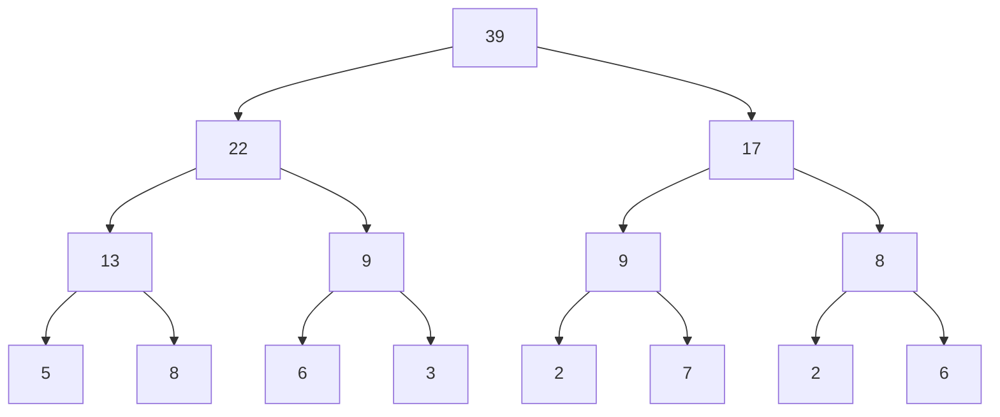
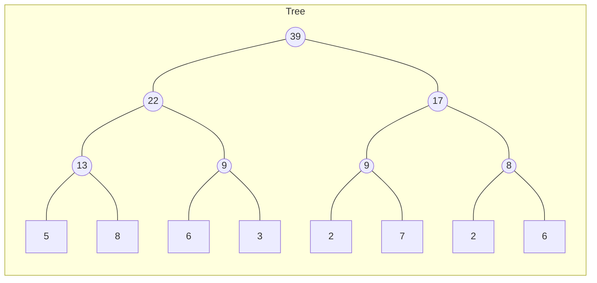
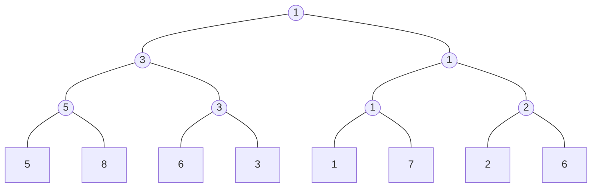
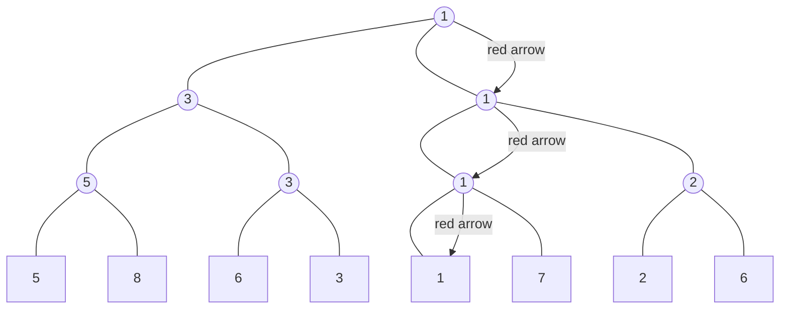

# **Chapter 9**

## **Range queries**

In this chapter, we discuss data structures that allow us to efficiently process range queries. In a **range query**, our task is to calculate a value based on a subarray of an array. Typical range queries are:

* `sum<sub>q</sub>(a, b)`: calculate the sum of values in range $[a, b]$
* `min<sub>q</sub>(a, b)`: find the minimum value in range $[a, b]$
* `max<sub>q</sub>(a, b)`: find the maximum value in range $[a, b]$

For example, consider the range $[3, 6]$ in the following array:

<table><thead><tr><th>0</th><th>1</th><th>2</th><th>3</th><th>4</th><th>5</th><th>6</th><th>7</th></tr></thead><tbody><tr><td>1</td><td>3</td><td>8</td><td>4</td><td>6</td><td>1</td><td>3</td><td>4</td></tr></tbody></table>

In this case, `sum<sub>q</sub>(3, 6) = 14`, `min<sub>q</sub>(3, 6) = 1` and `max<sub>q</sub>(3, 6) = 6`.

A simple way to process range queries is to use a loop that goes through all array values in the range. For example, the following function can be used to process sum queries on an array:

```cpp
int sum(int a, int b) {
    int s = 0;
    for (int i = a; i <= b; i++) {
        s += array[i];
    }
    return s;
}
```

This function works in $O(n)$ time, where $n$ is the size of the array. Thus, we can process $q$ queries in $O(nq)$ time using the function. However, if both $n$ and $q$ are large, this approach is slow. Fortunately, it turns out that there are ways to process range queries much more efficiently.

83

# **Static array queries**

We first focus on a situation where the array is *static*, i.e., the array values are never updated between the queries. In this case, it suffices to construct a static data structure that tells us the answer for any possible query.

## **Sum queries**

We can easily process sum queries on a static array by constructing a **prefix sum array**. Each value in the prefix sum array equals the sum of values in the original array up to that position, i.e., the value at position $k$ is $sum_q(0, k)$. The prefix sum array can be constructed in $O(n)$ time.

For example, consider the following array:

<table><thead><tr><th>0</th><th>1</th><th>2</th><th>3</th><th>4</th><th>5</th><th>6</th><th>7</th></tr></thead><tbody><tr><td>1</td><td>3</td><td>4</td><td>8</td><td>6</td><td>1</td><td>4</td><td>2</td></tr></tbody></table>

The corresponding prefix sum array is as follows:

<table><thead><tr><th>0</th><th>1</th><th>2</th><th>3</th><th>4</th><th>5</th><th>6</th><th>7</th></tr></thead><tbody><tr><td>1</td><td>4</td><td>8</td><td>16</td><td>22</td><td>23</td><td>27</td><td>29</td></tr></tbody></table>

Since the prefix sum array contains all values of $sum_q(0, k)$, we can calculate any value of $sum_q(a, b)$ in $O(1)$ time as follows:

$$sum_q(a, b) = sum_q(0, b) - sum_q(0, a - 1)$$

By defining $sum_q(0, -1) = 0$, the above formula also holds when $a = 0$.

For example, consider the range $[3, 6]$:

<table><thead><tr><th>0</th><th>1</th><th>2</th><th>3</th><th>4</th><th>5</th><th>6</th><th>7</th></tr></thead><tbody><tr><td>1</td><td>3</td><td>4</td><td>8</td><td>6</td><td>1</td><td>4</td><td>2</td></tr></tbody></table>

In this case $sum_q(3, 6) = 8 + 6 + 1 + 4 = 19$. This sum can be calculated from two values of the prefix sum array:

<table><thead><tr><th>0</th><th>1</th><th>2</th><th>3</th><th>4</th><th>5</th><th>6</th><th>7</th></tr></thead><tbody><tr><td>1</td><td>4</td><td>8</td><td>16</td><td>22</td><td>23</td><td>27</td><td>29</td></tr></tbody></table>

Thus, $sum_q(3, 6) = sum_q(0, 6) - sum_q(0, 2) = 27 - 8 = 19$.

It is also possible to generalize this idea to higher dimensions. For example, we can construct a two-dimensional prefix sum array that can be used to calculate the sum of any rectangular subarray in $O(1)$ time. Each sum in such an array corresponds to a subarray that begins at the upper-left corner of the array.

84

The following picture illustrates the idea:

image:

<table>
    <tr>
      <td></td>
      <td></td>
      <td></td>
      <td></td>
      <td></td>
      <td></td>
      <td></td>
      <td></td>
      <td></td>
      <td></td>
    </tr>
    <tr>
      <td></td>
      <td></td>
      <td>D</td>
      <td></td>
      <td></td>
      <td></td>
      <td>C</td>
      <td></td>
      <td></td>
      <td></td>
    </tr>
    <tr>
      <td></td>
      <td></td>
      <td></td>
      <td></td>
      <td></td>
      <td></td>
      <td></td>
      <td></td>
      <td></td>
      <td></td>
    </tr>
    <tr>
      <td></td>
      <td></td>
      <td></td>
      <td></td>
      <td></td>
      <td></td>
      <td></td>
      <td></td>
      <td></td>
      <td></td>
    </tr>
    <tr>
      <td></td>
      <td></td>
      <td>B</td>
      <td></td>
      <td></td>
      <td></td>
      <td>A</td>
      <td></td>
      <td></td>
      <td></td>
    </tr>
    <tr>
      <td></td>
      <td></td>
      <td></td>
      <td></td>
      <td></td>
      <td></td>
      <td></td>
      <td></td>
      <td></td>
      <td></td>
    </tr>
    <tr>
      <td></td>
      <td></td>
      <td></td>
      <td></td>
      <td></td>
      <td></td>
      <td></td>
      <td></td>
      <td></td>
      <td></td>
    </tr>
</table>

The sum of the gray subarray can be calculated using the formula

$$S(A) - S(B) - S(C) + S(D),$$

where $S(X)$ denotes the sum of values in a rectangular subarray from the upper-left corner to the position of $X$.

## **Minimum queries**

Minimum queries are more difficult to process than sum queries. Still, there is a quite simple $O(n \log n)$ time preprocessing method after which we can answer any minimum query in $O(1)$ time<sup>1</sup>. Note that since minimum and maximum queries can be processed similarly, we can focus on minimum queries.

The idea is to precalculate all values of $\min_q(a, b)$ where $b - a + 1$ (the length of the range) is a power of two. For example, for the array

<table><thead><tr><th>0</th><th>1</th><th>2</th><th>3</th><th>4</th><th>5</th><th>6</th><th>7</th></tr></thead><tbody><tr><td>1</td><td>3</td><td>4</td><td>8</td><td>6</td><td>1</td><td>4</td><td>2</td></tr></tbody></table>

the following values are calculated:

<table><thead><tr><th>a</th><th>b</th><th>min_q(a,b)</th></tr></thead><tbody><tr><td>0</td><td>0</td><td>1</td></tr><tr><td>1</td><td>1</td><td>3</td></tr><tr><td>2</td><td>2</td><td>4</td></tr><tr><td>3</td><td>3</td><td>8</td></tr><tr><td>4</td><td>4</td><td>6</td></tr><tr><td>5</td><td>5</td><td>1</td></tr><tr><td>6</td><td>6</td><td>4</td></tr><tr><td>7</td><td>7</td><td>2</td></tr></tbody></table>

<table><thead><tr><th>a</th><th>b</th><th>min_q(a,b)</th></tr></thead><tbody><tr><td>0</td><td>1</td><td>1</td></tr><tr><td>1</td><td>2</td><td>3</td></tr><tr><td>2</td><td>3</td><td>4</td></tr><tr><td>3</td><td>4</td><td>6</td></tr><tr><td>4</td><td>5</td><td>1</td></tr><tr><td>5</td><td>6</td><td>1</td></tr><tr><td>6</td><td>7</td><td>2</td></tr></tbody></table>

<table><thead><tr><th>a</th><th>b</th><th>min_q(a,b)</th></tr></thead><tbody><tr><td>0</td><td>3</td><td>1</td></tr><tr><td>1</td><td>4</td><td>3</td></tr><tr><td>2</td><td>5</td><td>1</td></tr><tr><td>3</td><td>6</td><td>1</td></tr><tr><td>4</td><td>7</td><td>1</td></tr><tr><td>0</td><td>7</td><td>1</td></tr></tbody></table>

The number of precalculated values is $O(n \log n)$, because there are $O(\log n)$ range lengths that are powers of two. The values can be calculated efficiently using the recursive formula

$$\min_q(a, b) = \min(\min_q(a, a + w - 1), \min_q(a + w, b)),$$

----

<sup>1</sup>This technique was introduced in [7] and sometimes called the **sparse table** method. There are also more sophisticated techniques [22] where the preprocessing time is only $O(n)$, but such algorithms are not needed in competitive programming.

85

where $b - a + 1$ is a power of two and $w = (b - a + 1)/2$. Calculating all those values takes $O(n \log n)$ time.

After this, any value of $\min_q(a, b)$ can be calculated in $O(1)$ time as a minimum of two precalculated values. Let $k$ be the largest power of two that does not exceed $b - a + 1$. We can calculate the value of $\min_q(a, b)$ using the formula

$$\min_q(a, b) = \min(\min_q(a, a + k - 1), \min_q(b - k + 1, b)).$$

In the above formula, the range $[a, b]$ is represented as the union of the ranges $[a, a + k - 1]$ and $[b - k + 1, b]$, both of length $k$.

As an example, consider the range $[1, 6]$:

<table><tr><td>0</td><td>1</td><td>2</td><td>3</td><td>4</td><td>5</td><td>6</td><td>7</td></tr><tr><td>1</td><td>3</td><td>4</td><td>8</td><td>6</td><td>1</td><td>4</td><td>2</td></tr></table>

The length of the range is 6, and the largest power of two that does not exceed 6 is 4. Thus the range $[1, 6]$ is the union of the ranges $[1, 4]$ and $[3, 6]$:

<table><tr><td>0</td><td>1</td><td>2</td><td>3</td><td>4</td><td>5</td><td>6</td><td>7</td></tr><tr><td>1</td><td>3</td><td>4</td><td>8</td><td>6</td><td>1</td><td>4</td><td>2</td></tr></table>

<table><tr><td>0</td><td>1</td><td>2</td><td>3</td><td>4</td><td>5</td><td>6</td><td>7</td></tr><tr><td>1</td><td>3</td><td>4</td><td>8</td><td>6</td><td>1</td><td>4</td><td>2</td></tr></table>

Since $\min_q(1, 4) = 3$ and $\min_q(3, 6) = 1$, we conclude that $\min_q(1, 6) = 1$.

## **Binary indexed tree**

A **binary indexed tree** or a **Fenwick tree**<sup>2</sup> can be seen as a dynamic variant of a prefix sum array. It supports two $O(\log n)$ time operations on an array: processing a range sum query and updating a value.

The advantage of a binary indexed tree is that it allows us to efficiently update array values between sum queries. This would not be possible using a prefix sum array, because after each update, it would be necessary to build the whole prefix sum array again in $O(n)$ time.

### **Structure**

Even if the name of the structure is a binary indexed *tree*, it is usually represented as an array. In this section we assume that all arrays are one-indexed, because it makes the implementation easier.

Let $p(k)$ denote the largest power of two that divides $k$. We store a binary indexed tree as an array tree such that

$$tree[k] = sum_q(k - p(k) + 1, k),$$

----

<sup>2</sup>The binary indexed tree structure was presented by P. M. Fenwick in 1994 [21].

86

i.e., each position $k$ contains the sum of values in a range of the original array whose length is $p(k)$ and that ends at position $k$. For example, since $p(6) = 2$, tree[6] contains the value of sum$_q(5, 6)$.

For example, consider the following array:

<table><thead><tr><th>1</th><th>2</th><th>3</th><th>4</th><th>5</th><th>6</th><th>7</th><th>8</th></tr></thead><tbody><tr><td>1</td><td>3</td><td>4</td><td>8</td><td>6</td><td>1</td><td>4</td><td>2</td></tr></tbody></table>

The corresponding binary indexed tree is as follows:

<table><thead><tr><th>1</th><th>2</th><th>3</th><th>4</th><th>5</th><th>6</th><th>7</th><th>8</th></tr></thead><tbody><tr><td>1</td><td>4</td><td>4</td><td>16</td><td>6</td><td>7</td><td>4</td><td>29</td></tr></tbody></table>

The following picture shows more clearly how each value in the binary indexed tree corresponds to a range in the original array:

drawing: binary indexed tree diagram

Using a binary indexed tree, any value of sum$_q(1, k)$ can be calculated in $O(\log n)$ time, because a range $[1, k]$ can always be divided into $O(\log n)$ ranges whose sums are stored in the tree.

For example, the range $[1, 7]$ consists of the following ranges:

drawing: binary indexed tree diagram

Thus, we can calculate the corresponding sum as follows:

$$sum_q(1, 7) = sum_q(1, 4) + sum_q(5, 6) + sum_q(7, 7) = 16 + 7 + 4 = 27$$

To calculate the value of $sum_q(a, b)$ where $a > 1$, we can use the same trick that we used with prefix sum arrays:

$$sum_q(a, b) = sum_q(1, b) - sum_q(1, a - 1).$$

87

Since we can calculate both `sum<sub>q</sub>(1, b)` and `sum<sub>q</sub>(1, a - 1)` in $O(\log n)$ time, the total time complexity is $O(\log n)$.

Then, after updating a value in the original array, several values in the binary indexed tree should be updated. For example, if the value at position 3 changes, the sums of the following ranges change:

```mermaid
graph TD
    subgraph "Binary Indexed Tree"
        direction TB
        1["1"]
        2["4"]
        3["4"]
        4["16"]
        5["6"]
        6["7"]
        7["4"]
        8["29"]
    end

    subgraph "Tree Nodes"
        direction TB
        N1[" "]
        N2[" "]
        N3[" "]
        N4[" "]
        N5[" "]
        N6[" "]
        N7[" "]
        N8[" "]
    end

    1 --> N1
    2 --> N2
    3 --> N3
    4 --> N4
    5 --> N5
    6 --> N6
    7 --> N7
    8 --> N8

    N1 --- N2
    N2 --- N3
    N3 --- N4
    N4 --- N5
    N5 --- N6
    N6 --- N7
    N7 --- N8

    style N1 fill:none,stroke:none
    style N2 fill:none,stroke:none
    style N3 fill:none,stroke:none
    style N4 fill:none,stroke:none
    style N5 fill:none,stroke:none
    style N6 fill:none,stroke:none
    style N7 fill:none,stroke:none
    style N8 fill:none,stroke:none
    style N1_2 fill:none,stroke:none
    style N2_3 fill:none,stroke:none
    style N3_4 fill:none,stroke:none
    style N4_5 fill:none,stroke:none
    style N5_6 fill:none,stroke:none
    style N6_7 fill:none,stroke:none
    style N7_8 fill:none,stroke:none
    style N1_2_3 fill:none,stroke:none
    style N2_3_4 fill:none,stroke:none
    style N3_4_5 fill:none,stroke:none
    style N4_5_6 fill:none,stroke:none
    style N5_6_7 fill:none,stroke:none
    style N6_7_8 fill:none,stroke:none
    style N1_2_3_4 fill:none,stroke:none
    style N2_3_4_5 fill:none,stroke:none
    style N3_4_5_6 fill:none,stroke:none
    style N4_5_6_7 fill:none,stroke:none
    style N5_6_7_8 fill:none,stroke:none
    style N1_2_3_4_5 fill:none,stroke:none
    style N2_3_4_5_6 fill:none,stroke:none
    style N3_4_5_6_7 fill:none,stroke:none
    style N4_5_6_7_8 fill:none,stroke:none
    style N1_2_3_4_5_6 fill:none,stroke:none
    style N2_3_4_5_6_7 fill:none,stroke:none
    style N3_4_5_6_7_8 fill:none,stroke:none
    style N4_5_6_7_8_9 fill:none,stroke:none
    style N5_6_7_8_9_10 fill:none,stroke:none
    style N6_7_8_9_10_11 fill:none,stroke:none
    style N7_8_9_10_11_12 fill:none,stroke:none
    style N8_9_10_11_12_13 fill:none,stroke:none
    style N1_2_3_4_5_6_7_8 fill:none,stroke:none
    style N2_3_4_5_6_7_8_9 fill:none,stroke:none
    style N3_4_5_6_7_8_9_10 fill:none,stroke:none
    style N4_5_6_7_8_9_10_11 fill:none,stroke:none
    style N5_6_7_8_9_10_11_12 fill:none,stroke:none
    style N6_7_8_9_10_11_12_13 fill:none,stroke:none
    style N7_8_9_10_11_12_13_14 fill:none,stroke:none
    style N8_9_10_11_12_13_14_15 fill:none,stroke:none
    style N1_2_3_4_5_6_7_8_9 fill:none,stroke:none
    style N2_3_4_5_6_7_8_9_10 fill:none,stroke:none
    style N3_4_5_6_7_8_9_10_11 fill:none,stroke:none
    style N4_5_6_7_8_9_10_11_12 fill:none,stroke:none
    style N5_6_7_8_9_10_11_12_13 fill:none,stroke:none
    style N6_7_8_9_10_11_12_13_14 fill:none,stroke:none
    style N7_8_9_10_11_12_13_14_15 fill:none,stroke:none
    style N8_9_10_11_12_13_14_15_16 fill:none,stroke:none
```



Since each array element belongs to $O(\log n)$ ranges in the binary indexed tree, it suffices to update $O(\log n)$ values in the tree.

## **Implementation**

The operations of a binary indexed tree can be efficiently implemented using bit operations. The key fact needed is that we can calculate any value of $p(k)$ using the formula

$$p(k) = k \& -k.$$

The following function calculates the value of `sum<sub>q</sub>(1, k)`:

```cpp
int sum(int k) {
    int s = 0;
    while (k >= 1) {
        s += tree[k];
        k -= k&-k;
    }
    return s;
}
```

The following function increases the array value at position $k$ by $x$ ($x$ can be positive or negative):

```cpp
void add(int k, int x) {
    while (k <= n) {
        tree[k] += x;
        k += k&-k;
    }
}
```

The time complexity of both the functions is $O(\log n)$, because the functions access $O(\log n)$ values in the binary indexed tree, and each move to the next position takes $O(1)$ time.

88

# **Segment tree**

A **segment tree**<sup>3</sup> is a data structure that supports two operations: processing a range query and updating an array value. Segment trees can support sum queries, minimum and maximum queries and many other queries so that both operations work in $O(\log n)$ time.

Compared to a binary indexed tree, the advantage of a segment tree is that it is a more general data structure. While binary indexed trees only support sum queries<sup>4</sup>, segment trees also support other queries. On the other hand, a segment tree requires more memory and is a bit more difficult to implement.

## **Structure**

A segment tree is a binary tree such that the nodes on the bottom level of the tree correspond to the array elements, and the other nodes contain information needed for processing range queries.

In this section, we assume that the size of the array is a power of two and zero-based indexing is used, because it is convenient to build a segment tree for such an array. If the size of the array is not a power of two, we can always append extra elements to it.

We will first discuss segment trees that support sum queries. As an example, consider the following array:

<table><thead><tr><th>0</th><th>1</th><th>2</th><th>3</th><th>4</th><th>5</th><th>6</th><th>7</th></tr></thead><tbody><tr><td>5</td><td>8</td><td>6</td><td>3</td><td>2</td><td>7</td><td>2</td><td>6</td></tr></tbody></table>

The corresponding segment tree is as follows:



Each internal tree node corresponds to an array range whose size is a power of two. In the above tree, the value of each internal node is the sum of the corresponding array values, and it can be calculated as the sum of the values of its left and right child node.

----

<sup>3</sup>The bottom-up-implementation in this chapter corresponds to that in [62]. Similar structures were used in late 1970’s to solve geometric problems [9].

<sup>4</sup>In fact, using *two* binary indexed trees it is possible to support minimum queries [16], but this is more complicated than to use a segment tree.

89

It turns out that any range $[a, b]$ can be divided into $O(\log n)$ ranges whose values are stored in tree nodes. For example, consider the range $[2,7]$:

<table><thead><tr><th>0</th><th>1</th><th>2</th><th>3</th><th>4</th><th>5</th><th>6</th><th>7</th></tr></thead><tbody><tr><td>5</td><td>8</td><td>6</td><td>3</td><td>2</td><td>7</td><td>2</td><td>6</td></tr></tbody></table>

Here $sum_q(2, 7) = 6 + 3 + 2 + 7 + 2 + 6 = 26$. In this case, the following two tree nodes correspond to the range:

flow_chart: tree diagram showing nodes 39, 22, 17, 13, 9, 9, 8 and array values 5, 8, 6, 3, 2, 7, 2, 6


Thus, another way to calculate the sum is $9 + 17 = 26$.

When the sum is calculated using nodes located as high as possible in the tree, at most two nodes on each level of the tree are needed. Hence, the total number of nodes is $O(\log n)$.

After an array update, we should update all nodes whose value depends on the updated value. This can be done by traversing the path from the updated array element to the top node and updating the nodes along the path.

The following picture shows which tree nodes change if the array value 7 changes:

flow_chart: tree diagram showing nodes 39, 22, 17, 13, 9, 9, 8 and array values 5, 8, 6, 3, 2, 7, 2, 6


The path from bottom to top always consists of $O(\log n)$ nodes, so each update changes $O(\log n)$ nodes in the tree.

## **Implementation**

We store a segment tree as an array of $2n$ elements where $n$ is the size of the original array and a power of two. The tree nodes are stored from top to bottom:

90

tree[1] is the top node, tree[2] and tree[3] are its children, and so on. Finally, the values from tree[n] to tree[2n − 1] correspond to the values of the original array on the bottom level of the tree.

For example, the segment tree



is stored as follows:

<table><thead><tr><th>1</th><th>2</th><th>3</th><th>4</th><th>5</th><th>6</th><th>7</th><th>8</th><th>9</th><th>10</th><th>11</th><th>12</th><th>13</th><th>14</th><th>15</th></tr></thead><tbody><tr><td>39</td><td>22</td><td>17</td><td>13</td><td>9</td><td>9</td><td>8</td><td>5</td><td>8</td><td>6</td><td>3</td><td>2</td><td>7</td><td>2</td><td>6</td></tr></tbody></table>

Using this representation, the parent of tree[k] is tree[[k/2]], and its children are tree[2k] and tree[2k + 1]. Note that this implies that the position of a node is even if it is a left child and odd if it is a right child.

The following function calculates the value of sum<sub>q</sub>(a, b):

```cpp
int sum(int a, int b) {
    a += n; b += n;
    int s = 0;
    while (a <= b) {
        if (a%2 == 1) s += tree[a++];
        if (b%2 == 0) s += tree[b--];
        a /= 2; b /= 2;
    }
    return s;
}
```

The function maintains a range that is initially [a + n, b + n]. Then, at each step, the range is moved one level higher in the tree, and before that, the values of the nodes that do not belong to the higher range are added to the sum.

The following function increases the array value at position k by x:

```cpp
void add(int k, int x) {
    k += n;
    tree[k] += x;
    for (k /= 2; k >= 1; k /= 2) {
        tree[k] = tree[2*k] + tree[2*k+1];
    }
}
```

91

First the function updates the value at the bottom level of the tree. After this, the function updates the values of all internal tree nodes, until it reaches the top node of the tree.

Both the above functions work in $O(\log n)$ time, because a segment tree of $n$ elements consists of $O(\log n)$ levels, and the functions move one level higher in the tree at each step.

## **Other queries**

Segment trees can support all range queries where it is possible to divide a range into two parts, calculate the answer separately for both parts and then efficiently combine the answers. Examples of such queries are minimum and maximum, greatest common divisor, and bit operations and, or and xor.

For example, the following segment tree supports minimum queries:



In this case, every tree node contains the smallest value in the corresponding array range. The top node of the tree contains the smallest value in the whole array. The operations can be implemented like previously, but instead of sums, minima are calculated.

The structure of a segment tree also allows us to use binary search for locating array elements. For example, if the tree supports minimum queries, we can find the position of an element with the smallest value in $O(\log n)$ time.

For example, in the above tree, an element with the smallest value 1 can be found by traversing a path downwards from the top node:



92

# **Additional techniques**

## **Index compression**

A limitation in data structures that are built upon an array is that the elements are indexed using consecutive integers. Difficulties arise when large indices are needed. For example, if we wish to use the index $10^9$, the array should contain $10^9$ elements which would require too much memory.

However, we can often bypass this limitation by using **index compression**, where the original indices are replaced with indices 1, 2, 3, etc. This can be done if we know all the indices needed during the algorithm beforehand.

The idea is to replace each original index $x$ with $c(x)$ where $c$ is a function that compresses the indices. We require that the order of the indices does not change, so if $a < b$, then $c(a) < c(b)$. This allows us to conveniently perform queries even if the indices are compressed.

For example, if the original indices are 555, $10^9$ and 8, the new indices are:

$$c(8) = 1$$
$$c(555) = 2$$
$$c(10^9) = 3$$

## **Range updates**

So far, we have implemented data structures that support range queries and updates of single values. Let us now consider an opposite situation, where we should update ranges and retrieve single values. We focus on an operation that increases all elements in a range $[a, b]$ by $x$.

Surprisingly, we can use the data structures presented in this chapter also in this situation. To do this, we build a **difference array** whose values indicate the differences between consecutive values in the original array. Thus, the original array is the prefix sum array of the difference array. For example, consider the following array:

<table><tr><td>0</td><td>1</td><td>2</td><td>3</td><td>4</td><td>5</td><td>6</td><td>7</td></tr><tr><td>3</td><td>3</td><td>1</td><td>1</td><td>1</td><td>5</td><td>2</td><td>2</td></tr></table>

The difference array for the above array is as follows:

<table><tr><td>0</td><td>1</td><td>2</td><td>3</td><td>4</td><td>5</td><td>6</td><td>7</td></tr><tr><td>3</td><td>0</td><td>-2</td><td>0</td><td>0</td><td>4</td><td>-3</td><td>0</td></tr></table>

For example, the value 2 at position 6 in the original array corresponds to the sum $3 - 2 + 4 - 3 = 2$ in the difference array.

The advantage of the difference array is that we can update a range in the original array by changing just two elements in the difference array. For example, if we want to increase the original array values between positions 1 and 4 by 5, it suffices to increase the difference array value at position 1 by 5 and decrease the value at position 5 by 5. The result is as follows:

93

<table><tr><td>0</td><td>1</td><td>2</td><td>3</td><td>4</td><td>5</td><td>6</td><td>7</td></tr><tr><td>3</td><td>5</td><td>-2</td><td>0</td><td>0</td><td>-1</td><td>-3</td><td>0</td></tr></table>

More generally, to increase the values in range $[a, b]$ by $x$, we increase the value at position $a$ by $x$ and decrease the value at position $b + 1$ by $x$. Thus, it is only needed to update single values and process sum queries, so we can use a binary indexed tree or a segment tree.

A more difficult problem is to support both range queries and range updates. In Chapter 28 we will see that even this is possible.

94

