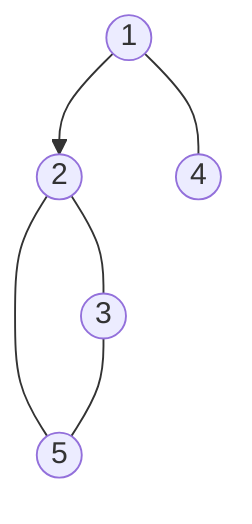
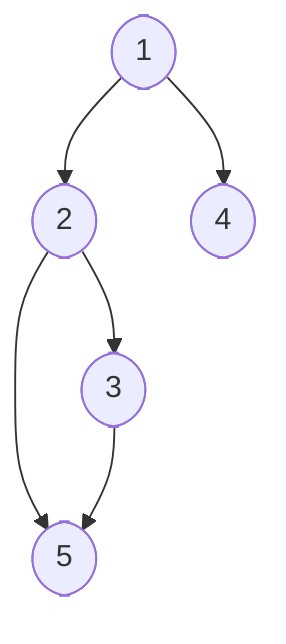
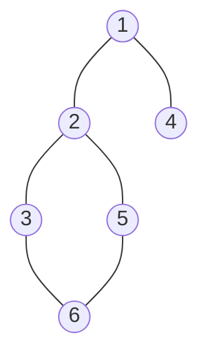
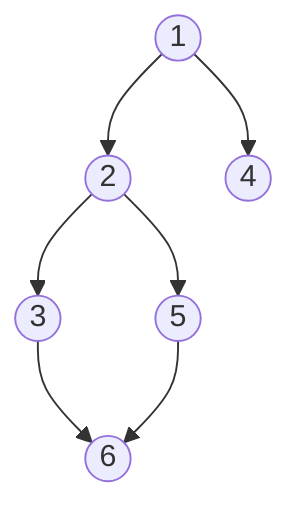
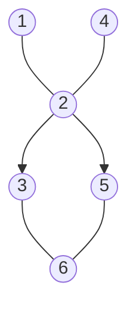
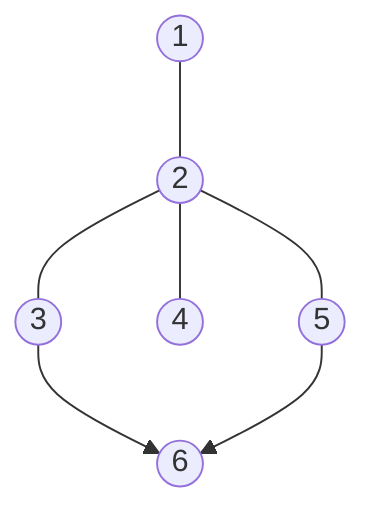
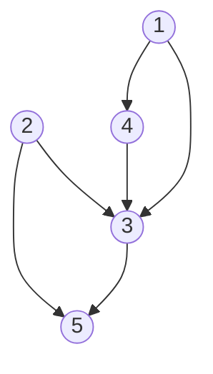
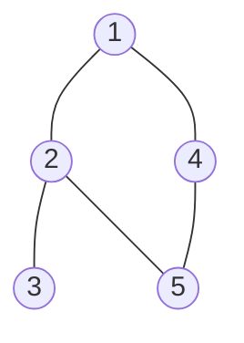
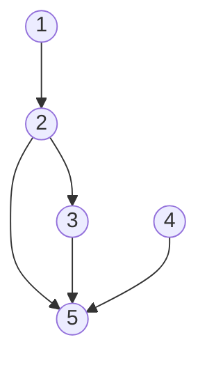

# **Chapter 12**

## **Graph traversal**

This chapter discusses two fundamental graph algorithms: depth-first search and breadth-first search. Both algorithms are given a starting node in the graph, and they visit all nodes that can be reached from the starting node. The difference in the algorithms is the order in which they visit the nodes.

### **Depth-first search**

**Depth-first search** (DFS) is a straightforward graph traversal technique. The algorithm begins at a starting node, and proceeds to all other nodes that are reachable from the starting node using the edges of the graph.

Depth-first search always follows a single path in the graph as long as it finds new nodes. After this, it returns to previous nodes and begins to explore other parts of the graph. The algorithm keeps track of visited nodes, so that it processes each node only once.

### **Example**

Let us consider how depth-first search processes the following graph:

flow_chart: graph showing nodes 1, 2, 3, 4, and 5 with edges between them


We may begin the search at any node of the graph; now we will begin the search at node 1.

The search first proceeds to node 2:

flow_chart: graph showing nodes 1, 2, 3, 4, and 5 with edges between them



117

After this, nodes 3 and 5 will be visited:

flow_chart: graph showing nodes 1-5 with red arrows



The neighbors of node 5 are 2 and 3, but the search has already visited both of them, so it is time to return to the previous nodes. Also the neighbors of nodes 3 and 2 have been visited, so we next move from node 1 to node 4:

flow_chart: graph showing nodes 1-5 with red arrows


After this, the search terminates because it has visited all nodes.

The time complexity of depth-first search is $O(n + m)$ where $n$ is the number of nodes and $m$ is the number of edges, because the algorithm processes each node and edge once.

## **Implementation**

Depth-first search can be conveniently implemented using recursion. The following function `dfs` begins a depth-first search at a given node. The function assumes that the graph is stored as adjacency lists in an array

```cpp
vector<int> adj[N];
```

and also maintains an array

```cpp
bool visited[N];
```

that keeps track of the visited nodes. Initially, each array value is false, and when the search arrives at node $s$, the value of `visited[s]` becomes true. The function can be implemented as follows:

```cpp
void dfs(int s) {
    if (visited[s]) return;
    visited[s] = true;
    // process node s
    for (auto u: adj[s]) {
        dfs(u);
    }
}
```

118

# **Breadth-first search**

**Breadth-first search** (BFS) visits the nodes in increasing order of their distance from the starting node. Thus, we can calculate the distance from the starting node to all other nodes using breadth-first search. However, breadth-first search is more difficult to implement than depth-first search.

Breadth-first search goes through the nodes one level after another. First the search explores the nodes whose distance from the starting node is 1, then the nodes whose distance is 2, and so on. This process continues until all nodes have been visited.

## **Example**

Let us consider how breadth-first search processes the following graph:

flow_chart: graph with nodes 1-6



Suppose that the search begins at node 1. First, we process all nodes that can be reached from node 1 using a single edge:

flow_chart: graph with nodes 1-6 and red arrows



After this, we proceed to nodes 3 and 5:

flow_chart: graph with nodes 1-6 and red arrows



Finally, we visit node 6:

flow_chart: graph with nodes 1-6 and red arrows



119

Now we have calculated the distances from the starting node to all nodes of the graph. The distances are as follows:

<table><thead><tr><th>node</th><th>distance</th></tr></thead><tbody><tr><td>1</td><td>0</td></tr><tr><td>2</td><td>1</td></tr><tr><td>3</td><td>2</td></tr><tr><td>4</td><td>1</td></tr><tr><td>5</td><td>2</td></tr><tr><td>6</td><td>3</td></tr></tbody></table>

Like in depth-first search, the time complexity of breadth-first search is $O(n + m)$, where $n$ is the number of nodes and $m$ is the number of edges.

## **Implementation**

Breadth-first search is more difficult to implement than depth-first search, because the algorithm visits nodes in different parts of the graph. A typical implementation is based on a queue that contains nodes. At each step, the next node in the queue will be processed.

The following code assumes that the graph is stored as adjacency lists and maintains the following data structures:

```cpp
queue<int> q;
bool visited[N];
int distance[N];
```

The queue `q` contains nodes to be processed in increasing order of their distance. New nodes are always added to the end of the queue, and the node at the beginning of the queue is the next node to be processed. The array `visited` indicates which nodes the search has already visited, and the array `distance` will contain the distances from the starting node to all nodes of the graph.

The search can be implemented as follows, starting at node $x$:

```cpp
visited[x] = true;
distance[x] = 0;
q.push(x);
while (!q.empty()) {
    int s = q.front(); q.pop();
    // process node s
    for (auto u : adj[s]) {
        if (visited[u]) continue;
        visited[u] = true;
        distance[u] = distance[s] + 1;
        q.push(u);
    }
}
```

120

# **Applications**

Using the graph traversal algorithms, we can check many properties of graphs. Usually, both depth-first search and breadth-first search may be used, but in practice, depth-first search is a better choice, because it is easier to implement. In the following applications we will assume that the graph is undirected.

## **Connectivity check**

A graph is connected if there is a path between any two nodes of the graph. Thus, we can check if a graph is connected by starting at an arbitrary node and finding out if we can reach all other nodes.

For example, in the graph

drawing: graph with nodes 1, 2, 3, 4, 5

a depth-first search from node 1 visits the following nodes:

drawing: depth-first search path from node 1 to 4

Since the search did not visit all the nodes, we can conclude that the graph is not connected. In a similar way, we can also find all connected components of a graph by iterating through the nodes and always starting a new depth-first search if the current node does not belong to any component yet.

## **Finding cycles**

A graph contains a cycle if during a graph traversal, we find a node whose neighbor (other than the previous node in the current path) has already been visited. For example, the graph

drawing: graph with nodes 1, 2, 3, 4, 5

contains two cycles and we can find one of them as follows:

121

flow_chart: graph showing nodes 1, 2, 3, 4, and 5 with red arrows



After moving from node 2 to node 5 we notice that the neighbor 3 of node 5 has already been visited. Thus, the graph contains a cycle that goes through node 3, for example, $3 \rightarrow 2 \rightarrow 5 \rightarrow 3$.

Another way to find out whether a graph contains a cycle is to simply calculate the number of nodes and edges in every component. If a component contains $c$ nodes and no cycle, it must contain exactly $c - 1$ edges (so it has to be a tree). If there are $c$ or more edges, the component surely contains a cycle.

## **Bipartiteness check**

A graph is bipartite if its nodes can be colored using two colors so that there are no adjacent nodes with the same color. It is surprisingly easy to check if a graph is bipartite using graph traversal algorithms.

The idea is to color the starting node blue, all its neighbors red, all their neighbors blue, and so on. If at some point of the search we notice that two adjacent nodes have the same color, this means that the graph is not bipartite. Otherwise the graph is bipartite and one coloring has been found.

For example, the graph

flow_chart: graph showing nodes 1, 2, 3, 4, and 5 with black edges



is not bipartite, because a search from node 1 proceeds as follows:

flow_chart: graph showing nodes 1, 2, 3, 4, and 5 with red arrows



We notice that the color or both nodes 2 and 5 is red, while they are adjacent nodes in the graph. Thus, the graph is not bipartite.

This algorithm always works, because when there are only two colors available, the color of the starting node in a component determines the colors of all other nodes in the component. It does not make any difference whether the starting node is red or blue.

Note that in the general case, it is difficult to find out if the nodes in a graph can be colored using $k$ colors so that no adjacent nodes have the same color. Even when $k = 3$, no efficient algorithm is known but the problem is NP-hard.

122

