# **Chapter 14**

## **Tree algorithms**

A **tree** is a connected, acyclic graph that consists of $n$ nodes and $n - 1$ edges. Removing any edge from a tree divides it into two components, and adding any edge to a tree creates a cycle. Moreover, there is always a unique path between any two nodes of a tree.

For example, the following tree consists of 8 nodes and 7 edges:

flow_chart: tree diagram with nodes 1-8

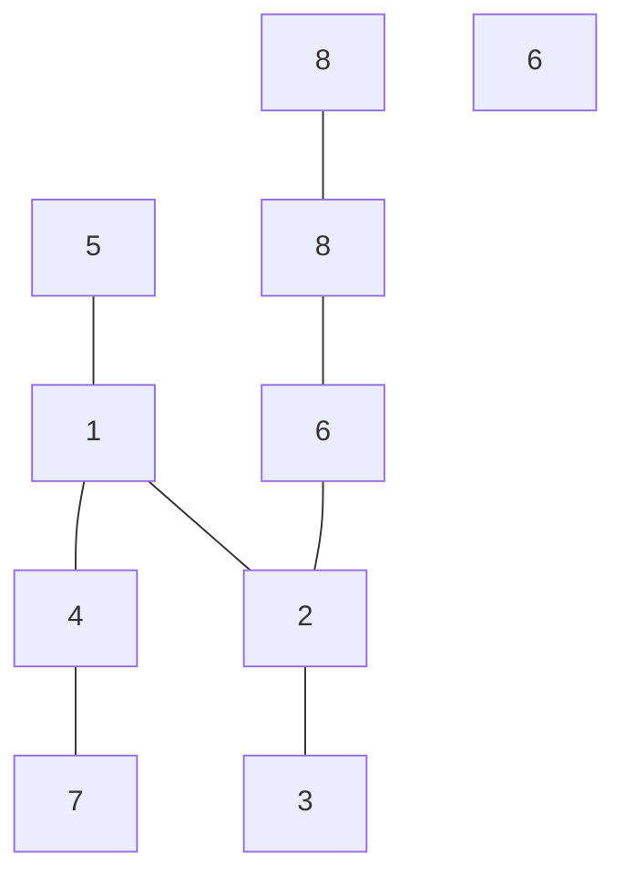

The **leaves** of a tree are the nodes with degree 1, i.e., with only one neighbor. For example, the leaves of the above tree are nodes 3, 5, 7 and 8.

In a **rooted** tree, one of the nodes is appointed the **root** of the tree, and all other nodes are placed underneath the root. For example, in the following tree, node 1 is the root node.

flow_chart: tree diagram with nodes 1-8

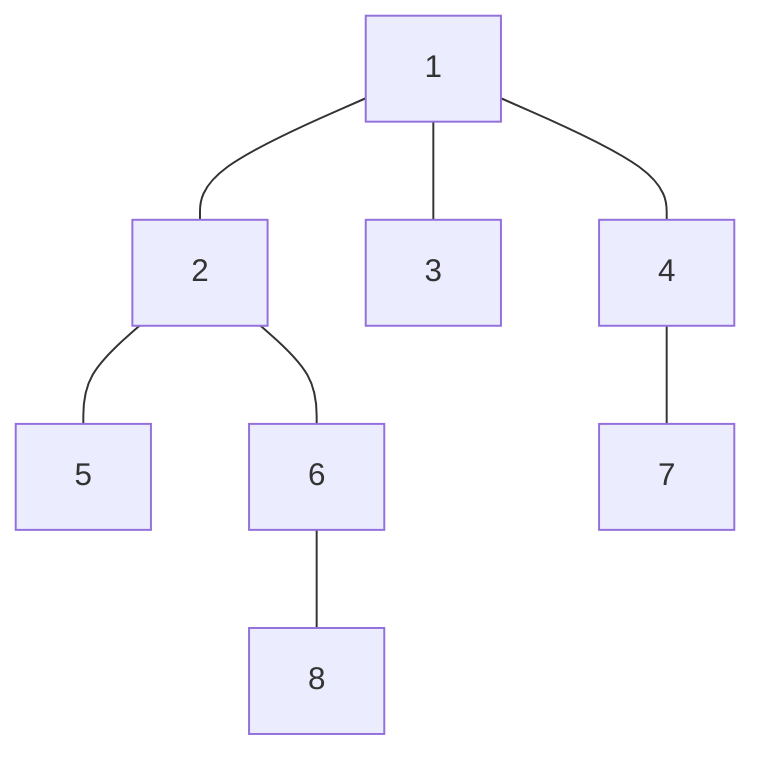

In a rooted tree, the **children** of a node are its lower neighbors, and the **parent** of a node is its upper neighbor. Each node has exactly one parent, except for the root that does not have a parent. For example, in the above tree, the children of node 2 are nodes 5 and 6, and its parent is node 1.

133

The structure of a rooted tree is *recursive*: each node of the tree acts as the root of a **subtree** that contains the node itself and all nodes that are in the subtrees of its children. For example, in the above tree, the subtree of node 2 consists of nodes 2, 5, 6 and 8:

flow_chart: tree diagram with nodes 2, 5, 6, and 8

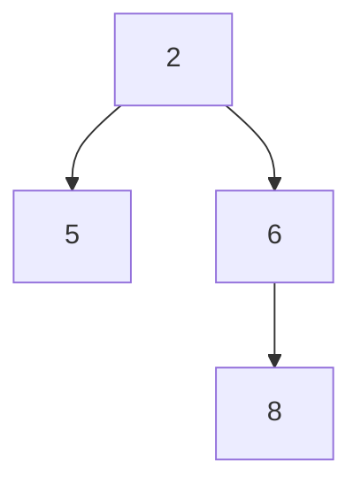

## **Tree traversal**

General graph traversal algorithms can be used to traverse the nodes of a tree. However, the traversal of a tree is easier to implement than that of a general graph, because there are no cycles in the tree and it is not possible to reach a node from multiple directions.

The typical way to traverse a tree is to start a depth-first search at an arbitrary node. The following recursive function can be used:

```cpp
void dfs(int s, int e) {
    // process node s
    for (auto u : adj[s]) {
        if (u != e) dfs(u, s);
    }
}
```

The function is given two parameters: the current node $s$ and the previous node $e$. The purpose of the parameter $e$ is to make sure that the search only moves to nodes that have not been visited yet.

The following function call starts the search at node $x$:

```cpp
dfs(x, 0);
```

In the first call $e = 0$, because there is no previous node, and it is allowed to proceed to any direction in the tree.

## **Dynamic programming**

Dynamic programming can be used to calculate some information during a tree traversal. Using dynamic programming, we can, for example, calculate in $O(n)$ time for each node of a rooted tree the number of nodes in its subtree or the length of the longest path from the node to a leaf.

134

As an example, let us calculate for each node $s$ a value `count[s]`: the number of nodes in its subtree. The subtree contains the node itself and all nodes in the subtrees of its children, so we can calculate the number of nodes recursively using the following code:

```cpp
void dfs(int s, int e) {
    count[s] = 1;
    for (auto u : adj[s]) {
        if (u == e) continue;
        dfs(u, s);
        count[s] += count[u];
    }
}
```

## **Diameter**

The **diameter** of a tree is the maximum length of a path between two nodes. For example, consider the following tree:

flow_chart: tree diagram with nodes 5, 1, 4, 6, 2, 3, 7

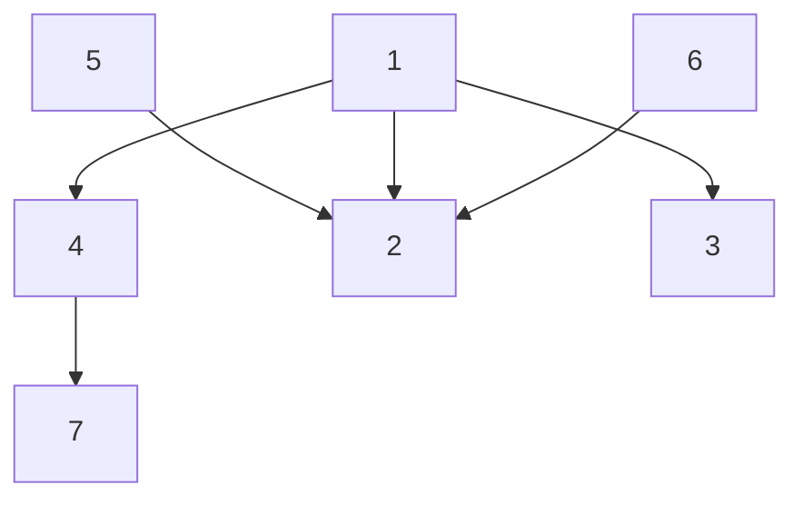

The diameter of this tree is 4, which corresponds to the following path:

flow_chart: tree diagram with nodes 5, 1, 4, 6, 2, 3, 7

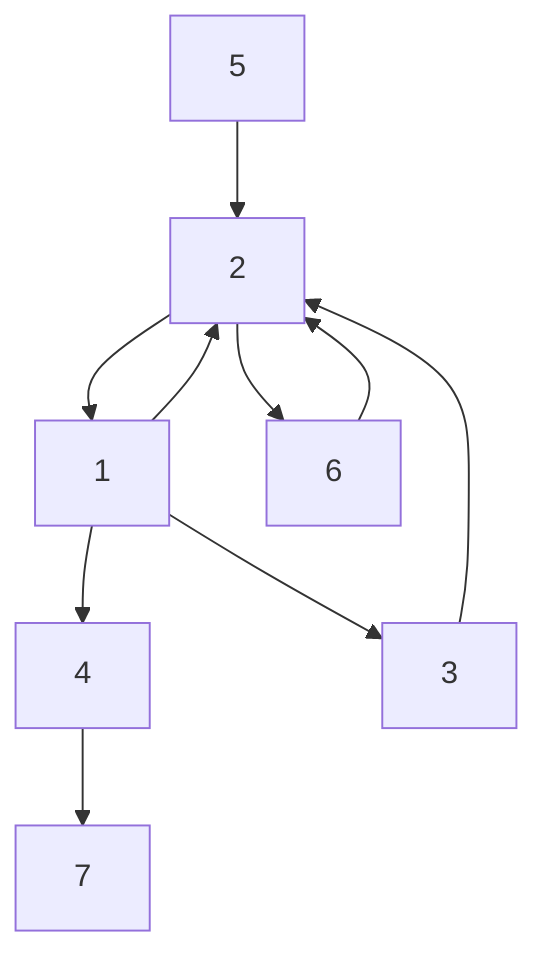

Note that there may be several maximum-length paths. In the above path, we could replace node 6 with node 5 to obtain another path with length 4.

Next we will discuss two $O(n)$ time algorithms for calculating the diameter of a tree. The first algorithm is based on dynamic programming, and the second algorithm uses two depth-first searches.

## **Algorithm 1**

A general way to approach many tree problems is to first root the tree arbitrarily. After this, we can try to solve the problem separately for each subtree. Our first algorithm for calculating the diameter is based on this idea.

An important observation is that every path in a rooted tree has a *highest point*: the highest node that belongs to the path. Thus, we can calculate for each

135

node the length of the longest path whose highest point is the node. One of those paths corresponds to the diameter of the tree.

For example, in the following tree, node 1 is the highest point on the path that corresponds to the diameter:

flow_chart: tree diagram with nodes 1, 2, 3, 4, 5, 6, 7

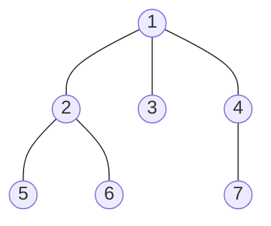

We calculate for each node $x$ two values:

* toLeaf($x$): the maximum length of a path from $x$ to any leaf
* maxLength($x$): the maximum length of a path whose highest point is $x$

For example, in the above tree, toLeaf(1) = 2, because there is a path 1 → 2 → 6, and maxLength(1) = 4, because there is a path 6 → 2 → 1 → 4 → 7. In this case, maxLength(1) equals the diameter.

Dynamic programming can be used to calculate the above values for all nodes in $O(n)$ time. First, to calculate toLeaf($x$), we go through the children of $x$, choose a child $c$ with maximum toLeaf($c$) and add one to this value. Then, to calculate maxLength($x$), we choose two distinct children $a$ and $b$ such that the sum toLeaf($a$) + toLeaf($b$) is maximum and add two to this sum.

## **Algorithm 2**

Another efficient way to calculate the diameter of a tree is based on two depth-first searches. First, we choose an arbitrary node $a$ in the tree and find the farthest node $b$ from $a$. Then, we find the farthest node $c$ from $b$. The diameter of the tree is the distance between $b$ and $c$.

In the following graph, $a$, $b$ and $c$ could be:

flow_chart: tree diagram with nodes 1, 2, 3, 4, 5, 6, 7

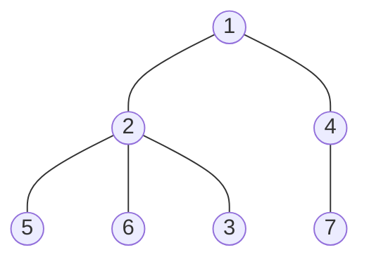

This is an elegant method, but why does it work?

It helps to draw the tree differently so that the path that corresponds to the diameter is horizontal, and all other nodes hang from it:

136

flow_chart: tree diagram with nodes 6, 2, 1, 4, 7, 5, 3

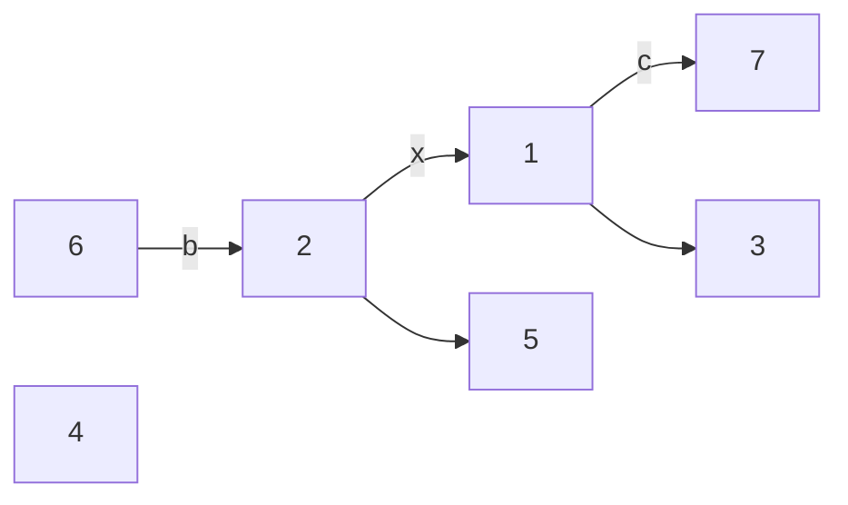

Node $x$ indicates the place where the path from node $a$ joins the path that corresponds to the diameter. The farthest node from $a$ is node $b$, node $c$ or some other node that is at least as far from node $x$. Thus, this node is always a valid choice for an endpoint of a path that corresponds to the diameter.

## **All longest paths**

Our next problem is to calculate for every node in the tree the maximum length of a path that begins at the node. This can be seen as a generalization of the tree diameter problem, because the largest of those lengths equals the diameter of the tree. Also this problem can be solved in $O(n)$ time.

As an example, consider the following tree:

flow_chart: tree diagram with nodes 1, 2, 3, 4, 5, 6

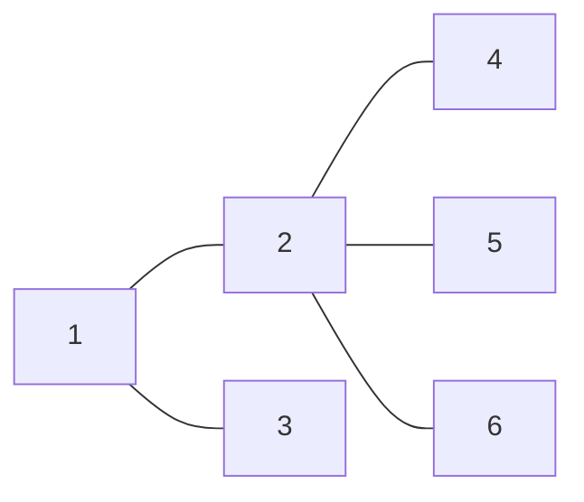

Let $maxLength(x)$ denote the maximum length of a path that begins at node $x$. For example, in the above tree, $maxLength(4) = 3$, because there is a path $4 \rightarrow 1 \rightarrow 2 \rightarrow 6$. Here is a complete table of the values:

<table><thead><tr><th>node x</th><th>1</th><th>2</th><th>3</th><th>4</th><th>5</th><th>6</th></tr></thead><tbody><tr><th>maxLength(x)</th><td>2</td><td>2</td><td>3</td><td>3</td><td>3</td><td>3</td></tr></tbody></table>

Also in this problem, a good starting point for solving the problem is to root the tree arbitrarily:

flow_chart: tree diagram with root node 1 and children 2, 3, 4, 5, 6

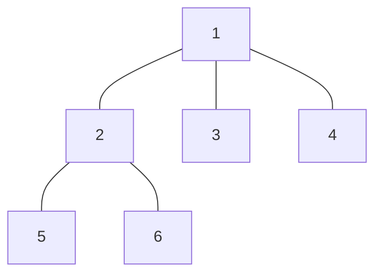

The first part of the problem is to calculate for every node $x$ the maximum length of a path that goes through a child of $x$. For example, the longest path from node 1 goes through its child 2:

137

flow_chart: tree diagram with nodes 1, 2, 3, 4, 5, 6

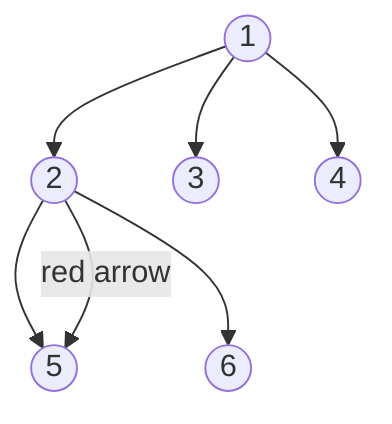

This part is easy to solve in $O(n)$ time, because we can use dynamic programming as we have done previously.

Then, the second part of the problem is to calculate for every node $x$ the maximum length of a path through its parent $p$. For example, the longest path from node 3 goes through its parent 1:

flow_chart: tree diagram with nodes 1, 2, 3, 4, 5, 6

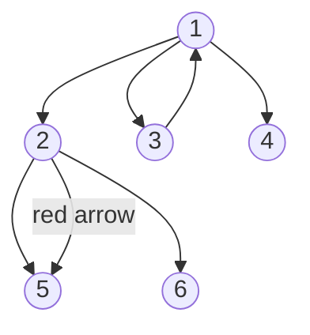

At first glance, it seems that we should choose the longest path from $p$. However, this *does not* always work, because the longest path from $p$ may go through $x$. Here is an example of this situation:

flow_chart: tree diagram with nodes 1, 2, 3, 4, 5, 6

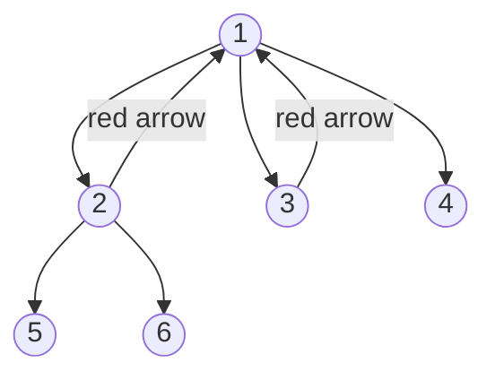

Still, we can solve the second part in $O(n)$ time by storing *two* maximum lengths for each node $x$:

* $maxLength_1(x)$: the maximum length of a path from $x$
* $maxLength_2(x)$ the maximum length of a path from $x$ in another direction than the first path

For example, in the above graph, $maxLength_1(1) = 2$ using the path $1 \to 2 \to 5$, and $maxLength_2(1) = 1$ using the path $1 \to 3$.

Finally, if the path that corresponds to $maxLength_1(p)$ goes through $x$, we conclude that the maximum length is $maxLength_2(p) + 1$, and otherwise the maximum length is $maxLength_1(p) + 1$.

138

# **Binary trees**

A **binary tree** is a rooted tree where each node has a left and right subtree. It is possible that a subtree of a node is empty. Thus, every node in a binary tree has zero, one or two children.

For example, the following tree is a binary tree:

flow_chart: binary tree diagram

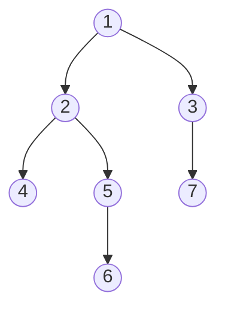

The nodes of a binary tree have three natural orderings that correspond to different ways to recursively traverse the tree:

* **pre-order:** first process the root, then traverse the left subtree, then traverse the right subtree
* **in-order:** first traverse the left subtree, then process the root, then traverse the right subtree
* **post-order:** first traverse the left subtree, then traverse the right subtree, then process the root

For the above tree, the nodes in pre-order are [1,2,4,5,6,3,7], in in-order [4,2,6,5,1,3,7] and in post-order [4,6,5,2,7,3,1].

If we know the pre-order and in-order of a tree, we can reconstruct the exact structure of the tree. For example, the above tree is the only possible tree with pre-order [1,2,4,5,6,3,7] and in-order [4,2,6,5,1,3,7]. In a similar way, the post-order and in-order also determine the structure of a tree.

However, the situation is different if we only know the pre-order and post-order of a tree. In this case, there may be more than one tree that match the orderings. For example, in both of the trees

flow_chart: two binary trees with nodes 1 and 2

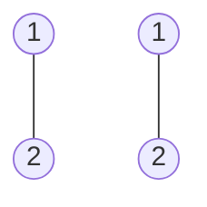

the pre-order is [1,2] and the post-order is [2,1], but the structures of the trees are different.

139

140

