# **Chapter 16**

## **Directed graphs**

In this chapter, we focus on two classes of directed graphs:

* **Acyclic graphs:** There are no cycles in the graph, so there is no path from any node to itself<sup>1</sup>.
* **Successor graphs:** The outdegree of each node is 1, so each node has a unique successor.

It turns out that in both cases, we can design efficient algorithms that are based on the special properties of the graphs.

## **Topological sorting**

A **topological sort** is an ordering of the nodes of a directed graph such that if there is a path from node $a$ to node $b$, then node $a$ appears before node $b$ in the ordering. For example, for the graph

flow_chart: directed graph with nodes 1-6

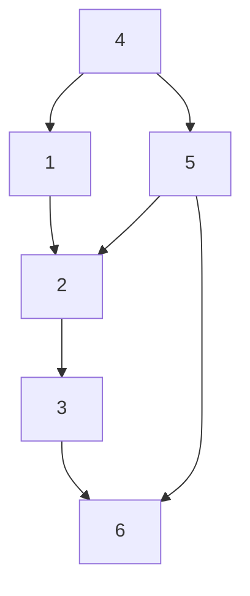

one topological sort is [4,1,5,2,3,6]:

flow_chart: directed graph showing nodes 4, 1, 5, 2, 3, 6

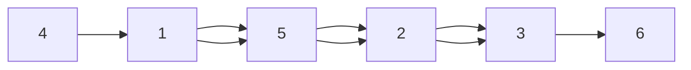

An acyclic graph always has a topological sort. However, if the graph contains a cycle, it is not possible to form a topological sort, because no node of the cycle can appear before the other nodes of the cycle in the ordering. It turns out that depth-first search can be used to both check if a directed graph contains a cycle and, if it does not contain a cycle, to construct a topological sort.

----

<sup>1</sup>Directed acyclic graphs are sometimes called DAGs.

149

# **Algorithm**

The idea is to go through the nodes of the graph and always begin a depth-first search at the current node if it has not been processed yet. During the searches, the nodes have three possible states:

* state 0: the node has not been processed (white)
* state 1: the node is under processing (light gray)
* state 2: the node has been processed (dark gray)

Initially, the state of each node is 0. When a search reaches a node for the first time, its state becomes 1. Finally, after all successors of the node have been processed, its state becomes 2.

If the graph contains a cycle, we will find this out during the search, because sooner or later we will arrive at a node whose state is 1. In this case, it is not possible to construct a topological sort.

If the graph does not contain a cycle, we can construct a topological sort by adding each node to a list when the state of the node becomes 2. This list in reverse order is a topological sort.

# **Example 1**

In the example graph, the search first proceeds from node 1 to node 6:

flow_chart: graph showing nodes 1-6 with edges

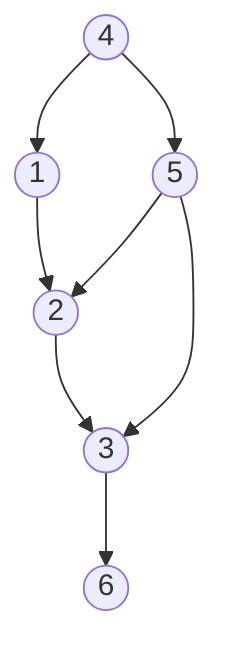

Now node 6 has been processed, so it is added to the list. After this, also nodes 3, 2 and 1 are added to the list:

flow_chart: graph showing nodes 1-6 with edges


At this point, the list is [6,3,2,1]. The next search begins at node 4:

flow_chart: graph showing nodes 1-6 with edges


150

Thus, the final list is [6, 3, 2, 1, 5, 4]. We have processed all nodes, so a topological sort has been found. The topological sort is the reverse list [4, 5, 1, 2, 3, 6]:

flow_chart: directed graph showing nodes 4, 5, 1, 2, 3, 6 with edges

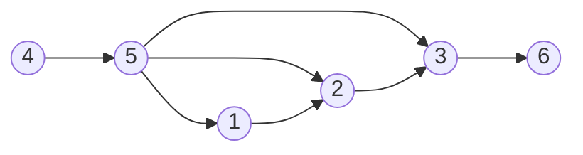

Note that a topological sort is not unique, and there can be several topological sorts for a graph.

## **Example 2**

Let us now consider a graph for which we cannot construct a topological sort, because the graph contains a cycle:

flow_chart: directed graph with nodes 1, 2, 3, 4, 5, 6

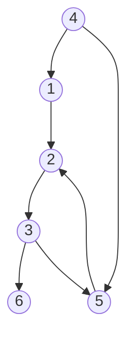

The search proceeds as follows:

flow_chart: directed graph with nodes 1, 2, 3, 4, 5, 6 and red arrows

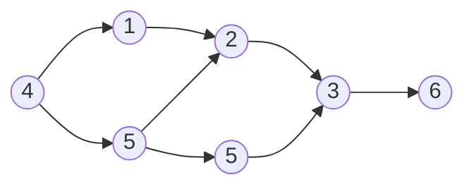

The search reaches node 2 whose state is 1, which means that the graph contains a cycle. In this example, there is a cycle 2 → 3 → 5 → 2.

## **Dynamic programming**

If a directed graph is acyclic, dynamic programming can be applied to it. For example, we can efficiently solve the following problems concerning paths from a starting node to an ending node:

* how many different paths are there?
* what is the shortest/longest path?
* what is the minimum/maximum number of edges in a path?
* which nodes certainly appear in any path?

151

# **Counting the number of paths**

As an example, let us calculate the number of paths from node 1 to node 6 in the following graph:

flow_chart: graph showing nodes 1 through 6 with directed edges

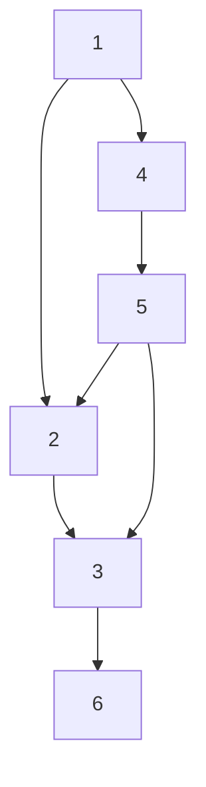

There are a total of three such paths:

* $1 \rightarrow 2 \rightarrow 3 \rightarrow 6$
* $1 \rightarrow 4 \rightarrow 5 \rightarrow 2 \rightarrow 3 \rightarrow 6$
* $1 \rightarrow 4 \rightarrow 5 \rightarrow 3 \rightarrow 6$

Let paths($x$) denote the number of paths from node 1 to node $x$. As a base case, paths(1) = 1. Then, to calculate other values of paths($x$), we may use the recursion

$$paths(x) = paths(a_1) + paths(a_2) + \cdots + paths(a_k)$$

where $a_1, a_2, \dots, a_k$ are the nodes from which there is an edge to $x$. Since the graph is acyclic, the values of paths($x$) can be calculated in the order of a topological sort. A topological sort for the above graph is as follows:

flow_chart: graph showing nodes 1 through 6 with directed edges

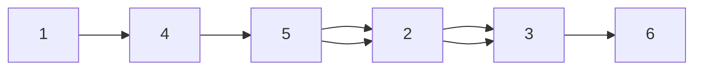

Hence, the numbers of paths are as follows:

flow_chart: graph showing nodes 1 through 6 with directed edges and red numbers

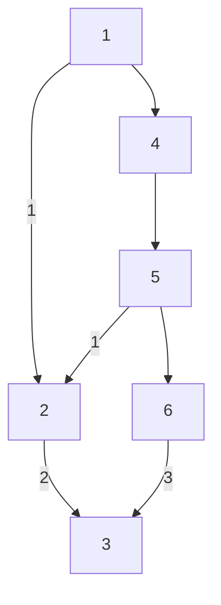

For example, to calculate the value of paths(3), we can use the formula paths(2) + paths(5), because there are edges from nodes 2 and 5 to node 3. Since paths(2) = 2 and paths(5) = 1, we conclude that paths(3) = 3.

152

# **Extending Dijkstra’s algorithm**

A by-product of Dijkstra’s algorithm is a directed, acyclic graph that indicates for each node of the original graph the possible ways to reach the node using a shortest path from the starting node. Dynamic programming can be applied to that graph. For example, in the graph

flow_chart: graph with nodes 1, 2, 3, 4, 5 and edges with weights

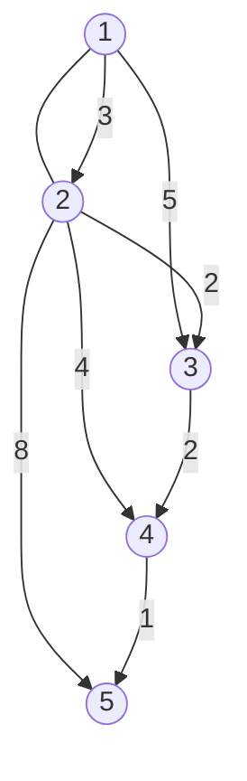

the shortest paths from node 1 may use the following edges:

flow_chart: graph with nodes 1, 2, 3, 4, 5 and edges with weights

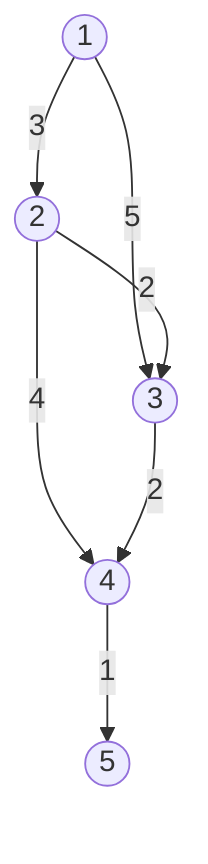

Now we can, for example, calculate the number of shortest paths from node 1 to node 5 using dynamic programming:

flow_chart: graph with nodes 1, 2, 3, 4, 5 and edges with weights


## **Representing problems as graphs**

Actually, any dynamic programming problem can be represented as a directed, acyclic graph. In such a graph, each node corresponds to a dynamic programming state and the edges indicate how the states depend on each other.

As an example, consider the problem of forming a sum of money $n$ using coins $\{c_1, c_2, \dots, c_k\}$. In this problem, we can construct a graph where each node corresponds to a sum of money, and the edges show how the coins can be chosen. For example, for coins $\{1, 3, 4\}$ and $n = 6$, the graph is as follows:

153

flow_chart: directed graph with nodes 0 through 6

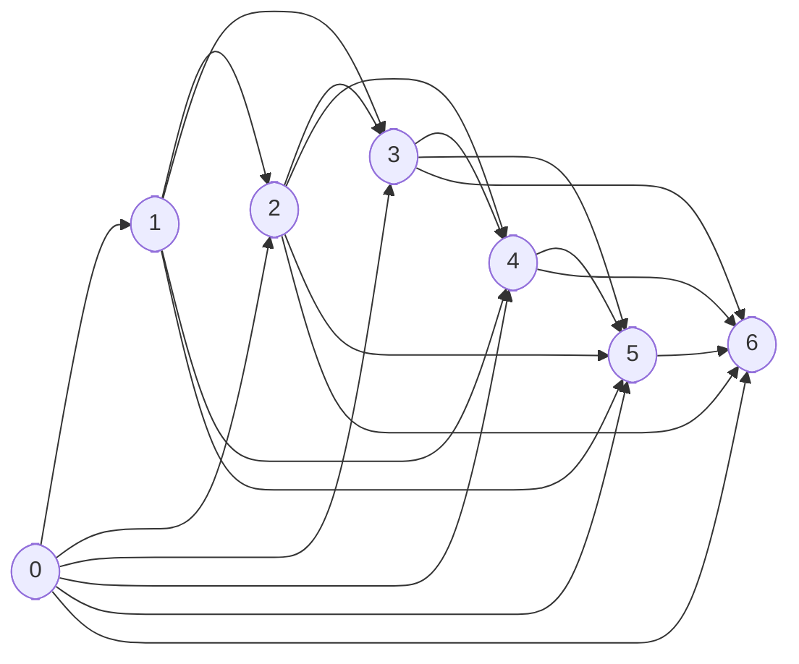

Using this representation, the shortest path from node 0 to node $n$ corresponds to a solution with the minimum number of coins, and the total number of paths from node 0 to node $n$ equals the total number of solutions.

## **Successor paths**

For the rest of the chapter, we will focus on **successor graphs**. In those graphs, the outdegree of each node is 1, i.e., exactly one edge starts at each node. A successor graph consists of one or more components, each of which contains one cycle and some paths that lead to it.

Successor graphs are sometimes called **functional graphs**. The reason for this is that any successor graph corresponds to a function that defines the edges of the graph. The parameter for the function is a node of the graph, and the function gives the successor of that node.

For example, the function

<table><thead><tr><th>$x$</th><th>1</th><th>2</th><th>3</th><th>4</th><th>5</th><th>6</th><th>7</th><th>8</th><th>9</th></tr></thead><tbody><tr><td>succ($x$)</td><td>3</td><td>5</td><td>7</td><td>6</td><td>2</td><td>2</td><td>1</td><td>6</td><td>3</td></tr></tbody></table>

defines the following graph:

flow_chart: directed graph with nodes 1 through 9

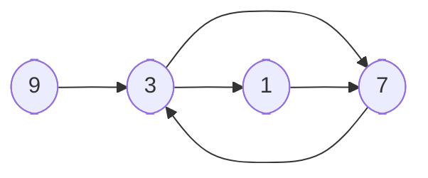

flow_chart: directed graph with nodes 2, 4, 5, 6, 7, 8

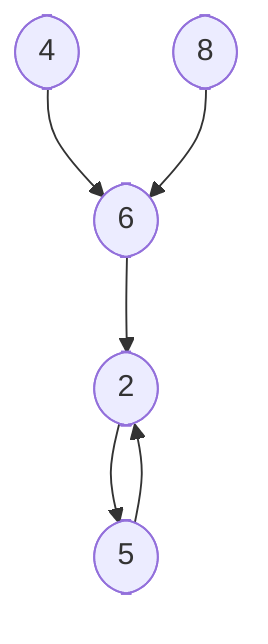

Since each node of a successor graph has a unique successor, we can also define a function $succ(x, k)$ that gives the node that we will reach if we begin at node $x$ and walk $k$ steps forward. For example, in the above graph $succ(4, 6) = 2$, because we will reach node 2 by walking 6 steps from node 4:

flow_chart: directed graph showing a path from node 4 to node 2

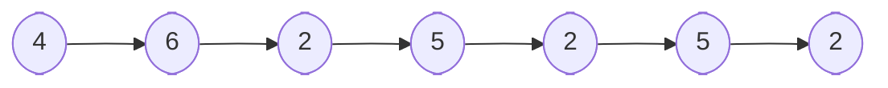

A straightforward way to calculate a value of $succ(x, k)$ is to start at node $x$ and walk $k$ steps forward, which takes $O(k)$ time. However, using preprocessing, any value of $succ(x, k)$ can be calculated in only $O(\log k)$ time.

The idea is to precalculate all values of $succ(x, k)$ where $k$ is a power of two and at most $u$, where $u$ is the maximum number of steps we will ever walk. This can be efficiently done, because we can use the following recursion:

154

$$succ(x, k) = \begin{cases} succ(x) & k = 1 \\ succ(succ(x, k/2), k/2) & k > 1 \end{cases}$$

Precalculating the values takes $O(n \log u)$ time, because $O(\log u)$ values are calculated for each node. In the above graph, the first values are as follows:

<table><thead><tr><th>$x$</th><th>1</th><th>2</th><th>3</th><th>4</th><th>5</th><th>6</th><th>7</th><th>8</th><th>9</th></tr></thead><tbody><tr><td>succ(x, 1)</td><td>3</td><td>5</td><td>7</td><td>6</td><td>2</td><td>2</td><td>1</td><td>6</td><td>3</td></tr><tr><td>succ(x, 2)</td><td>7</td><td>2</td><td>1</td><td>2</td><td>5</td><td>5</td><td>3</td><td>2</td><td>7</td></tr><tr><td>succ(x, 4)</td><td>3</td><td>2</td><td>7</td><td>2</td><td>5</td><td>5</td><td>1</td><td>2</td><td>3</td></tr><tr><td>succ(x, 8)</td><td>7</td><td>2</td><td>1</td><td>2</td><td>5</td><td>5</td><td>3</td><td>2</td><td>7</td></tr><tr><td>...</td><td></td><td></td><td></td><td></td><td></td><td></td><td></td><td></td><td></td></tr></tbody></table>

After this, any value of $succ(x, k)$ can be calculated by presenting the number of steps $k$ as a sum of powers of two. For example, if we want to calculate the value of $succ(x, 11)$, we first form the representation $11 = 8 + 2 + 1$. Using that,

$$succ(x, 11) = succ(succ(succ(x, 8), 2), 1).$$

For example, in the previous graph

$$succ(4, 11) = succ(succ(succ(4, 8), 2), 1) = 5.$$

Such a representation always consists of $O(\log k)$ parts, so calculating a value of $succ(x, k)$ takes $O(\log k)$ time.

## **Cycle detection**

Consider a successor graph that only contains a path that ends in a cycle. We may ask the following questions: if we begin our walk at the starting node, what is the first node in the cycle and how many nodes does the cycle contain?

For example, in the graph

flow_chart: graph with nodes 1, 2, 3, 4, 5, 6

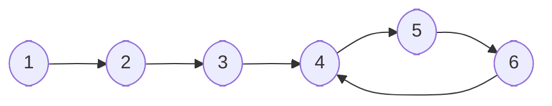

we begin our walk at node 1, the first node that belongs to the cycle is node 4, and the cycle consists of three nodes (4, 5 and 6).

A simple way to detect the cycle is to walk in the graph and keep track of all nodes that have been visited. Once a node is visited for the second time, we can conclude that the node is the first node in the cycle. This method works in $O(n)$ time and also uses $O(n)$ memory.

However, there are better algorithms for cycle detection. The time complexity of such algorithms is still $O(n)$, but they only use $O(1)$ memory. This is an important improvement if $n$ is large. Next we will discuss Floyd's algorithm that achieves these properties.

155

# Floyd’s algorithm

**Floyd’s algorithm**<sup>2</sup> walks forward in the graph using two pointers $a$ and $b$. Both pointers begin at a node $x$ that is the starting node of the graph. Then, on each turn, the pointer $a$ walks one step forward and the pointer $b$ walks two steps forward. The process continues until the pointers meet each other:

```text
a = succ(x);
b = succ(succ(x));
while (a != b) {
    a = succ(a);
    b = succ(succ(b));
}
```

At this point, the pointer $a$ has walked $k$ steps and the pointer $b$ has walked $2k$ steps, so the length of the cycle divides $k$. Thus, the first node that belongs to the cycle can be found by moving the pointer $a$ to node $x$ and advancing the pointers step by step until they meet again.

```text
a = x;
while (a != b) {
    a = succ(a);
    b = succ(b);
}
first = a;
```

After this, the length of the cycle can be calculated as follows:

```text
b = succ(a);
length = 1;
while (a != b) {
    b = succ(b);
    length++;
}
```

----

<sup>2</sup>The idea of the algorithm is mentioned in [46] and attributed to R. W. Floyd; however, it is not known if Floyd actually discovered the algorithm.

156

