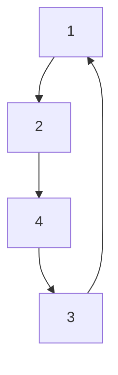
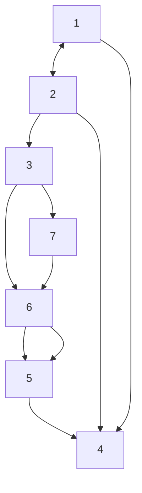
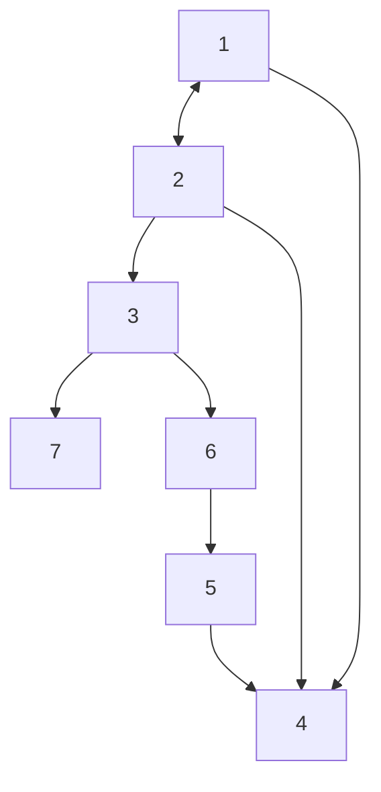
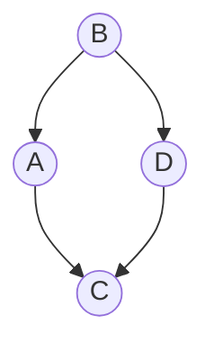
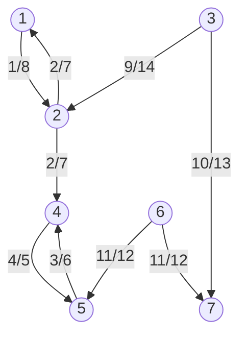
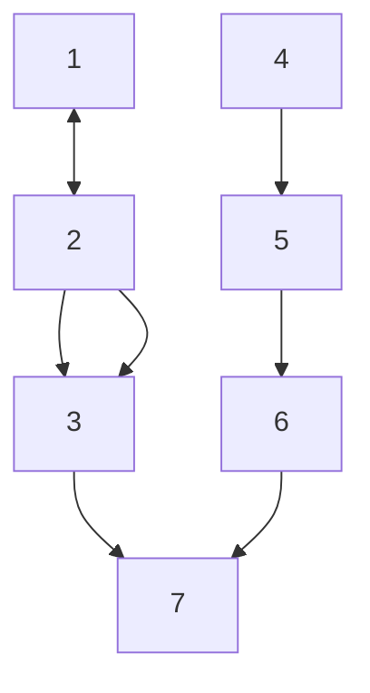
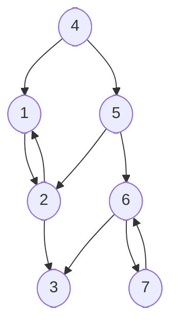
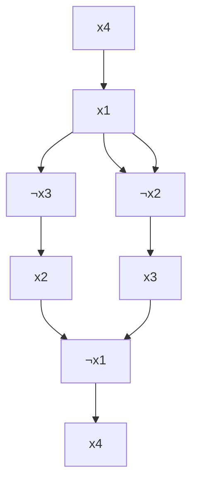
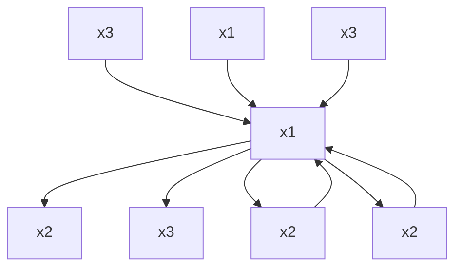
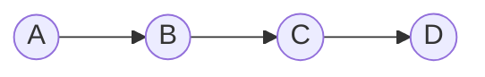

# **Chapter 17**

## **Strong connectivity**

In a directed graph, the edges can be traversed in one direction only, so even if the graph is connected, this does not guarantee that there would be a path from a node to another node. For this reason, it is meaningful to define a new concept that requires more than connectivity.

A graph is **strongly connected** if there is a path from any node to all other nodes in the graph. For example, in the following picture, the left graph is strongly connected while the right graph is not.

flow_chart: directed graph with nodes 1, 2, 3, 4

flow_chart: directed graph with nodes 1, 2, 3, 4

The right graph is not strongly connected because, for example, there is no path from node 2 to node 1.

The **strongly connected components** of a graph divide the graph into strongly connected parts that are as large as possible. The strongly connected components form an acyclic **component graph** that represents the deep structure of the original graph.

For example, for the graph

flow_chart: directed graph with nodes 1, 2, 3, 4, 5, 6, 7

the strongly connected components are as follows:

flow_chart: directed graph with nodes 1, 2, 3, 4, 5, 6, 7

157

The corresponding component graph is as follows:

flow_chart: directed graph with nodes A, B, C, D

The components are $A = \{1, 2\}$, $B = \{3, 6, 7\}$, $C = \{4\}$ and $D = \{5\}$.

A component graph is an acyclic, directed graph, so it is easier to process than the original graph. Since the graph does not contain cycles, we can always construct a topological sort and use dynamic programming techniques like those presented in Chapter 16.

## **Kosaraju’s algorithm**

**Kosaraju’s algorithm**1 is an efficient method for finding the strongly connected components of a directed graph. The algorithm performs two depth-first searches: the first search constructs a list of nodes according to the structure of the graph, and the second search forms the strongly connected components.

### **Search 1**

The first phase of Kosaraju’s algorithm constructs a list of nodes in the order in which a depth-first search processes them. The algorithm goes through the nodes, and begins a depth-first search at each unprocessed node. Each node will be added to the list after it has been processed.

In the example graph, the nodes are processed in the following order:

flow_chart: directed graph with nodes 1-7 and time intervals

The notation $x/y$ means that processing the node started at time $x$ and finished at time $y$. Thus, the corresponding list is as follows:

----

1According to [1], S. R. Kosaraju invented this algorithm in 1978 but did not publish it. In 1981, the same algorithm was rediscovered and published by M. Sharir [57].

158

<table><thead><tr><th>node</th><th>processing time</th></tr></thead><tbody><tr><td>4</td><td>5</td></tr><tr><td>5</td><td>6</td></tr><tr><td>2</td><td>7</td></tr><tr><td>1</td><td>8</td></tr><tr><td>6</td><td>12</td></tr><tr><td>7</td><td>13</td></tr><tr><td>3</td><td>14</td></tr></tbody></table>

## **Search 2**

The second phase of the algorithm forms the strongly connected components of the graph. First, the algorithm reverses every edge in the graph. This guarantees that during the second search, we will always find strongly connected components that do not have extra nodes.

After reversing the edges, the example graph is as follows:

flow_chart: graph showing nodes 1-7 with directed edges

After this, the algorithm goes through the list of nodes created by the first search, in *reverse* order. If a node does not belong to a component, the algorithm creates a new component and starts a depth-first search that adds all new nodes found during the search to the new component.

In the example graph, the first component begins at node 3:

flow_chart: graph showing nodes 1-7 with directed edges

Note that since all edges are reversed, the component does not "leak" to other parts in the graph.

159

The next nodes in the list are nodes 7 and 6, but they already belong to a component, so the next new component begins at node 1:

flow_chart: directed graph with nodes 1-7

Finally, the algorithm processes nodes 5 and 4 that create the remaining strongly connected components:

flow_chart: directed graph with nodes 1-7

The time complexity of the algorithm is $O(n + m)$, because the algorithm performs two depth-first searches.

## **2SAT problem**

Strong connectivity is also linked with the **2SAT problem**2. In this problem, we are given a logical formula

$$(a_1 \vee b_1) \wedge (a_2 \vee b_2) \wedge \dots \wedge (a_m \vee b_m),$$

where each $a_i$ and $b_i$ is either a logical variable ($x_1, x_2, \dots, x_n$) or a negation of a logical variable ($\neg x_1, \neg x_2, \dots, \neg x_n$). The symbols "∧" and "∨" denote logical operators "and" and "or". Our task is to assign each variable a value so that the formula is true, or state that this is not possible.

For example, the formula

$$L_1 = (x_2 \vee \neg x_1) \wedge (\neg x_1 \vee \neg x_2) \wedge (x_1 \vee x_3) \wedge (\neg x_2 \vee \neg x_3) \wedge (x_1 \vee x_4)$$

is true when the variables are assigned as follows:

$$\begin{cases}
x_1 = false \\
x_2 = false \\
x_3 = true \\
x_4 = true
\end{cases}$$

2The algorithm presented here was introduced in [4]. There is also another well-known linear-time algorithm [19] that is based on backtracking.

160

However, the formula

$$L_2 = (x_1 \vee x_2) \wedge (x_1 \vee \neg x_2) \wedge (\neg x_1 \vee x_3) \wedge (\neg x_1 \vee \neg x_3)$$

is always false, regardless of how we assign the values. The reason for this is that we cannot choose a value for $x_1$ without creating a contradiction. If $x_1$ is false, both $x_2$ and $\neg x_2$ should be true which is impossible, and if $x_1$ is true, both $x_3$ and $\neg x_3$ should be true which is also impossible.

The 2SAT problem can be represented as a graph whose nodes correspond to variables $x_i$ and negations $\neg x_i$, and edges determine the connections between the variables. Each pair $(a_i \vee b_i)$ generates two edges: $\neg a_i \to b_i$ and $\neg b_i \to a_i$. This means that if $a_i$ does not hold, $b_i$ must hold, and vice versa.

The graph for the formula $L_1$ is:

flow_chart: graph showing nodes x3, x2, x1, x4, x1, x2, x3, x4

And the graph for the formula $L_2$ is:

flow_chart: graph showing nodes x3, x2, x1, x2, x3, x1, x2, x3

The structure of the graph tells us whether it is possible to assign the values of the variables so that the formula is true. It turns out that this can be done exactly when there are no nodes $x_i$ and $\neg x_i$ such that both nodes belong to the same strongly connected component. If there are such nodes, the graph contains a path from $x_i$ to $\neg x_i$ and also a path from $\neg x_i$ to $x_i$, so both $x_i$ and $\neg x_i$ should be true which is not possible.

In the graph of the formula $L_1$ there are no nodes $x_i$ and $\neg x_i$ such that both nodes belong to the same strongly connected component, so a solution exists. In the graph of the formula $L_2$ all nodes belong to the same strongly connected component, so a solution does not exist.

If a solution exists, the values for the variables can be found by going through the nodes of the component graph in a reverse topological sort order. At each step, we process a component that does not contain edges that lead to an unprocessed component. If the variables in the component have not been assigned values, their values will be determined according to the values in the component, and if

161

they already have values, they remain unchanged. The process continues until each variable has been assigned a value.

The component graph for the formula $L_1$ is as follows:

flow_chart: component graph showing nodes A, B, C, and D in a linear sequence

The components are $A = \{\neg x_4\}$, $B = \{x_1, x_2, \neg x_3\}$, $C = \{\neg x_1, \neg x_2, x_3\}$ and $D = \{x_4\}$. When constructing the solution, we first process the component $D$ where $x_4$ becomes true. After this, we process the component $C$ where $x_1$ and $x_2$ become false and $x_3$ becomes true. All variables have been assigned values, so the remaining components $A$ and $B$ do not change the variables.

Note that this method works, because the graph has a special structure: if there are paths from node $x_i$ to node $x_j$ and from node $x_j$ to node $\neg x_j$, then node $x_i$ never becomes true. The reason for this is that there is also a path from node $\neg x_j$ to node $\neg x_i$, and both $x_i$ and $x_j$ become false.

A more difficult problem is the **3SAT problem**, where each part of the formula is of the form $(a_i \lor b_i \lor c_i)$. This problem is NP-hard, so no efficient algorithm for solving the problem is known.

162

