# **Chapter 18**

## **Tree queries**

This chapter discusses techniques for processing queries on subtrees and paths of a rooted tree. For example, such queries are:

* what is the $k$th ancestor of a node?
* what is the sum of values in the subtree of a node?
* what is the sum of values on a path between two nodes?
* what is the lowest common ancestor of two nodes?

## **Finding ancestors**

The $k$th **ancestor** of a node $x$ in a rooted tree is the node that we will reach if we move $k$ levels up from $x$. Let ancestor($x, k$) denote the $k$th ancestor of a node $x$ (or 0 if there is no such an ancestor). For example, in the following tree, ancestor(2, 1) = 1 and ancestor(8, 2) = 4.

flow_chart: tree diagram with nodes 1, 2, 3, 4, 5, 6, 7, 8

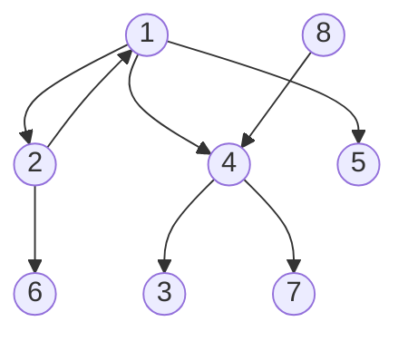

An easy way to calculate any value of ancestor($x, k$) is to perform a sequence of $k$ moves in the tree. However, the time complexity of this method is $O(k)$, which may be slow, because a tree of $n$ nodes may have a chain of $n$ nodes.

163

Fortunately, using a technique similar to that used in Chapter 16.3, any value of ancestor($x, k$) can be efficiently calculated in $O(\log k)$ time after preprocessing. The idea is to precalculate all values ancestor($x, k$) where $k \le n$ is a power of two. For example, the values for the above tree are as follows:

<table><thead><tr><th>x</th><th>1</th><th>2</th><th>3</th><th>4</th><th>5</th><th>6</th><th>7</th><th>8</th></tr></thead><tbody><tr><td>ancestor(x,1)</td><td>0</td><td>1</td><td>4</td><td>1</td><td>1</td><td>2</td><td>4</td><td>7</td></tr><tr><td>ancestor(x,2)</td><td>0</td><td>0</td><td>1</td><td>0</td><td>0</td><td>1</td><td>1</td><td>4</td></tr><tr><td>ancestor(x,4)</td><td>0</td><td>0</td><td>0</td><td>0</td><td>0</td><td>0</td><td>0</td><td>0</td></tr><tr><td>...</td><td></td><td></td><td></td><td></td><td></td><td></td><td></td><td></td></tr></tbody></table>

The preprocessing takes $O(n \log n)$ time, because $O(\log n)$ values are calculated for each node. After this, any value of ancestor($x, k$) can be calculated in $O(\log k)$ time by representing $k$ as a sum where each term is a power of two.

## **Subtrees and paths**

A **tree traversal array** contains the nodes of a rooted tree in the order in which a depth-first search from the root node visits them. For example, in the tree

flow_chart: tree diagram with nodes 1, 2, 3, 4, 5, 6, 7, 8, 9

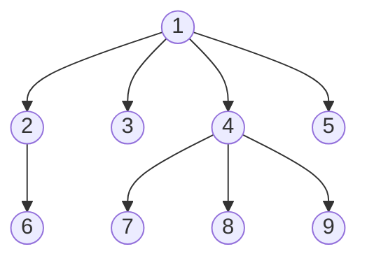

a depth-first search proceeds as follows:

flow_chart: tree diagram with nodes 1, 2, 3, 4, 5, 6, 7, 8, 9 and red arrows

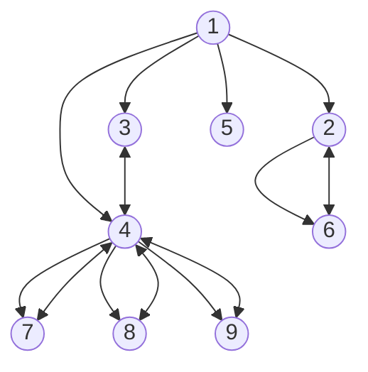

Hence, the corresponding tree traversal array is as follows:

<table><tr><td>1</td><td>2</td><td>6</td><td>3</td><td>4</td><td>7</td><td>8</td><td>9</td><td>5</td></tr></table>

164

# **Subtree queries**

Each subtree of a tree corresponds to a subarray of the tree traversal array such that the first element of the subarray is the root node. For example, the following subarray contains the nodes of the subtree of node 4:

```text
1 2 6 3 4 7 8 9 5
```

Using this fact, we can efficiently process queries that are related to subtrees of a tree. As an example, consider a problem where each node is assigned a value, and our task is to support the following queries:

* update the value of a node
* calculate the sum of values in the subtree of a node

Consider the following tree where the blue numbers are the values of the nodes. For example, the sum of the subtree of node 4 is $3 + 4 + 3 + 1 = 11$.


The idea is to construct a tree traversal array that contains three values for each node: the identifier of the node, the size of the subtree, and the value of the node. For example, the array for the above tree is as follows:

<table><thead><tr><th>node id</th><th>1</th><th>2</th><th>6</th><th>3</th><th>4</th><th>7</th><th>8</th><th>9</th><th>5</th></tr></thead><tbody><tr><th>subtree size</th><td>9</td><td>2</td><td>1</td><td>1</td><td>4</td><td>1</td><td>1</td><td>1</td><td>1</td></tr><tr><th>node value</th><td>2</td><td>3</td><td>4</td><td>5</td><td>3</td><td>4</td><td>3</td><td>1</td><td>1</td></tr></tbody></table>

Using this array, we can calculate the sum of values in any subtree by first finding out the size of the subtree and then the values of the corresponding nodes. For example, the values in the subtree of node 4 can be found as follows:

<table><thead><tr><th>node id</th><th>1</th><th>2</th><th>6</th><th>3</th><th>4</th><th>7</th><th>8</th><th>9</th><th>5</th></tr></thead><tbody><tr><th>subtree size</th><td>9</td><td>2</td><td>1</td><td>1</td><td>4</td><td>1</td><td>1</td><td>1</td><td>1</td></tr><tr><th>node value</th><td>2</td><td>3</td><td>4</td><td>5</td><td>3</td><td>4</td><td>3</td><td>1</td><td>1</td></tr></tbody></table>

To answer the queries efficiently, it suffices to store the values of the nodes in a binary indexed or segment tree. After this, we can both update a value and calculate the sum of values in $O(\log n)$ time.

165

# **Path queries**

Using a tree traversal array, we can also efficiently calculate sums of values on paths from the root node to any node of the tree. Consider a problem where our task is to support the following queries:

* change the value of a node
* calculate the sum of values on a path from the root to a node

For example, in the following tree, the sum of values from the root node to node 7 is $4 + 5 + 5 = 14$:

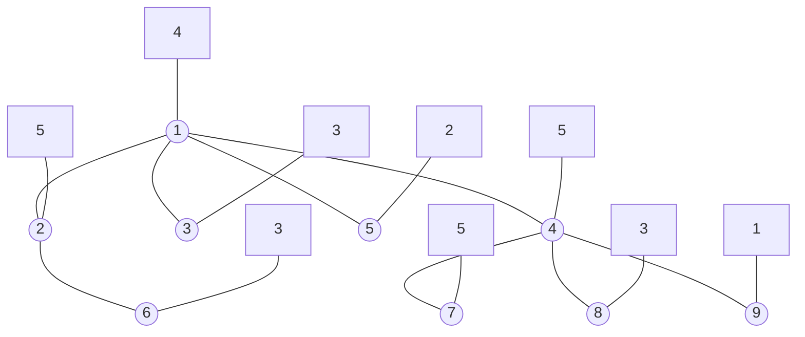

We can solve this problem like before, but now each value in the last row of the array is the sum of values on a path from the root to the node. For example, the following array corresponds to the above tree:

<table><thead><tr><th>node id</th><th>1</th><th>2</th><th>6</th><th>3</th><th>4</th><th>7</th><th>8</th><th>9</th><th>5</th></tr></thead><tbody><tr><th>subtree size</th><td>9</td><td>2</td><td>1</td><td>1</td><td>4</td><td>1</td><td>1</td><td>1</td><td>1</td></tr><tr><th>path sum</th><td>4</td><td>9</td><td>12</td><td>7</td><td>9</td><td>14</td><td>12</td><td>10</td><td>6</td></tr></tbody></table>

When the value of a node increases by $x$, the sums of all nodes in its subtree increase by $x$. For example, if the value of node 4 increases by 1, the array changes as follows:

<table><thead><tr><th>node id</th><th>1</th><th>2</th><th>6</th><th>3</th><th>4</th><th>7</th><th>8</th><th>9</th><th>5</th></tr></thead><tbody><tr><th>subtree size</th><td>9</td><td>2</td><td>1</td><td>1</td><td>4</td><td>1</td><td>1</td><td>1</td><td>1</td></tr><tr><th>path sum</th><td>4</td><td>9</td><td>12</td><td>7</td><td>10</td><td>15</td><td>13</td><td>11</td><td>6</td></tr></tbody></table>

Thus, to support both the operations, we should be able to increase all values in a range and retrieve a single value. This can be done in $O(\log n)$ time using a binary indexed or segment tree (see Chapter 9.4).

166

# **Lowest common ancestor**

The **lowest common ancestor** of two nodes of a rooted tree is the lowest node whose subtree contains both the nodes. A typical problem is to efficiently process queries that ask to find the lowest common ancestor of two nodes.

For example, in the following tree, the lowest common ancestor of nodes 5 and 8 is node 2:

flow_chart: tree diagram with nodes 1-8

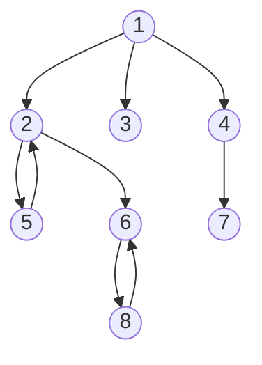

Next we will discuss two efficient techniques for finding the lowest common ancestor of two nodes.

## **Method 1**

One way to solve the problem is to use the fact that we can efficiently find the $k$th ancestor of any node in the tree. Using this, we can divide the problem of finding the lowest common ancestor into two parts.

We use two pointers that initially point to the two nodes whose lowest common ancestor we should find. First, we move one of the pointers upwards so that both pointers point to nodes at the same level.

In the example scenario, we move the second pointer one level up so that it points to node 6 which is at the same level with node 5:

flow_chart: tree diagram with nodes 1-8

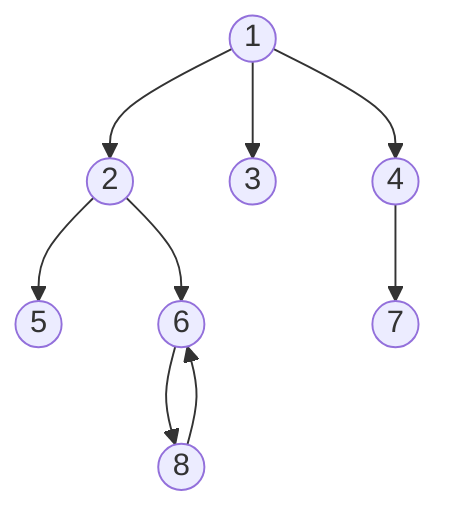

167

After this, we determine the minimum number of steps needed to move both pointers upwards so that they will point to the same node. The node to which the pointers point after this is the lowest common ancestor.

In the example scenario, it suffices to move both pointers one step upwards to node 2, which is the lowest common ancestor:

flow_chart: tree diagram with nodes 1-8 and bidirectional red arrows

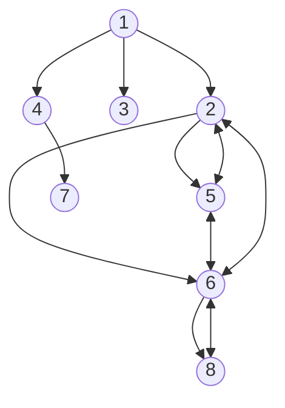

Since both parts of the algorithm can be performed in $O(\log n)$ time using precomputed information, we can find the lowest common ancestor of any two nodes in $O(\log n)$ time.

## **Method 2**

Another way to solve the problem is based on a tree traversal array<sup>1</sup>. Once again, the idea is to traverse the nodes using a depth-first search:

flow_chart: tree diagram with nodes 1-8 and bidirectional red arrows

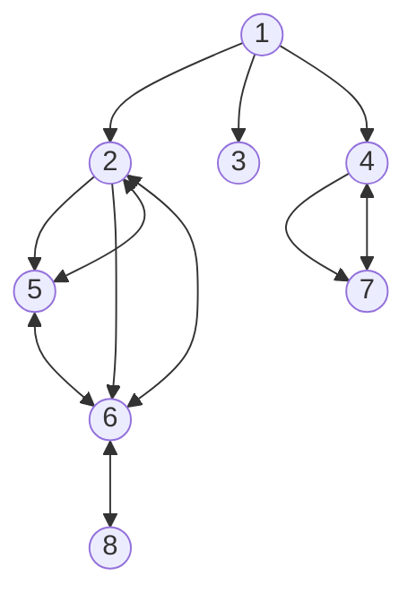

However, we use a different tree traversal array than before: we add each node to the array *always* when the depth-first search walks through the node, and not only at the first visit. Hence, a node that has $k$ children appears $k + 1$ times in the array and there are a total of $2n - 1$ nodes in the array.

----

<sup>1</sup>This lowest common ancestor algorithm was presented in [7]. This technique is sometimes called the **Euler tour technique** [66].

168

We store two values in the array: the identifier of the node and the depth of the node in the tree. The following array corresponds to the above tree:

<table><tr><td></td><th>0</th><th>1</th><th>2</th><th>3</th><th>4</th><th>5</th><th>6</th><th>7</th><th>8</th><th>9</th><th>10</th><th>11</th><th>12</th><th>13</th><th>14</th></tr><tr><td>node id</td><td>1</td><td>2</td><td>5</td><td>2</td><td>6</td><td>8</td><td>6</td><td>2</td><td>1</td><td>3</td><td>1</td><td>4</td><td>7</td><td>4</td><td>1</td></tr><tr><td>depth</td><td>1</td><td>2</td><td>3</td><td>2</td><td>3</td><td>4</td><td>3</td><td>2</td><td>1</td><td>2</td><td>1</td><td>2</td><td>3</td><td>2</td><td>1</td></tr></table>

Now we can find the lowest common ancestor of nodes $a$ and $b$ by finding the node with the *minimum* depth between nodes $a$ and $b$ in the array. For example, the lowest common ancestor of nodes 5 and 8 can be found as follows:

<table><tr><td></td><th>0</th><th>1</th><th>2</th><th>3</th><th>4</th><th>5</th><th>6</th><th>7</th><th>8</th><th>9</th><th>10</th><th>11</th><th>12</th><th>13</th><th>14</th></tr><tr><td>node id</td><td>1</td><td>2</td><td>5</td><td>2</td><td>6</td><td>8</td><td>6</td><td>2</td><td>1</td><td>3</td><td>1</td><td>4</td><td>7</td><td>4</td><td>1</td></tr><tr><td>depth</td><td>1</td><td>2</td><td>3</td><td>2</td><td>3</td><td>4</td><td>3</td><td>2</td><td>1</td><td>2</td><td>1</td><td>2</td><td>3</td><td>2</td><td>1</td></tr></table>

Node 5 is at position 2, node 8 is at position 5, and the node with minimum depth between positions 2...5 is node 2 at position 3 whose depth is 2. Thus, the lowest common ancestor of nodes 5 and 8 is node 2.

Thus, to find the lowest common ancestor of two nodes it suffices to process a range minimum query. Since the array is static, we can process such queries in $O(1)$ time after an $O(n \log n)$ time preprocessing.

## **Distances of nodes**

The distance between nodes $a$ and $b$ equals the length of the path from $a$ to $b$. It turns out that the problem of calculating the distance between nodes reduces to finding their lowest common ancestor.

First, we root the tree arbitrarily. After this, the distance of nodes $a$ and $b$ can be calculated using the formula

$$depth(a) + depth(b) - 2 \cdot depth(c),$$

where $c$ is the lowest common ancestor of $a$ and $b$ and $depth(s)$ denotes the depth of node $s$. For example, consider the distance of nodes 5 and 8:

flow_chart: tree diagram with nodes 1, 2, 3, 4, 5, 6, 7, and 8

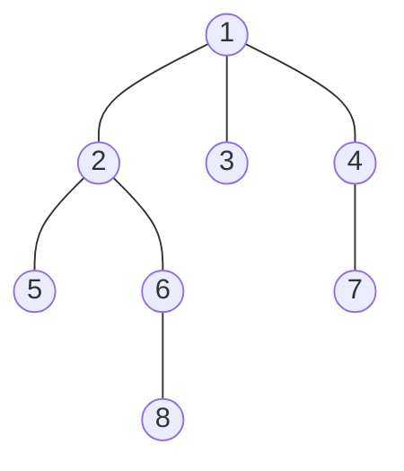

169

The lowest common ancestor of nodes 5 and 8 is node 2. The depths of the nodes are depth(5) = 3, depth(8) = 4 and depth(2) = 2, so the distance between nodes 5 and 8 is $3 + 4 - 2 \cdot 2 = 3$.

## **Offline algorithms**

So far, we have discussed *online* algorithms for tree queries. Those algorithms are able to process queries one after another so that each query is answered before receiving the next query.

However, in many problems, the online property is not necessary. In this section, we focus on *offline* algorithms. Those algorithms are given a set of queries which can be answered in any order. It is often easier to design an offline algorithm compared to an online algorithm.

## **Merging data structures**

One method to construct an offline algorithm is to perform a depth-first tree traversal and maintain data structures in nodes. At each node $s$, we create a data structure $d[s]$ that is based on the data structures of the children of $s$. Then, using this data structure, all queries related to $s$ are processed.

As an example, consider the following problem: We are given a tree where each node has some value. Our task is to process queries of the form "calculate the number of nodes with value $x$ in the subtree of node $s$". For example, in the following tree, the subtree of node 4 contains two nodes whose value is 3.

flow_chart: tree diagram with nodes and values

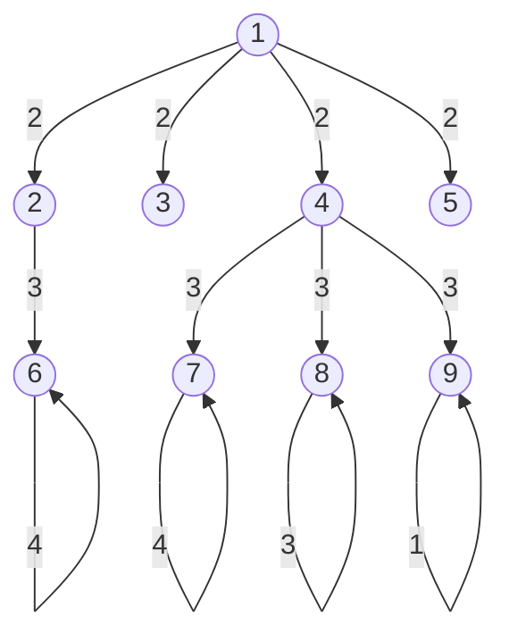

In this problem, we can use map structures to answer the queries. For example, the maps for node 4 and its children are as follows:

flow_chart: tree diagram of map structures

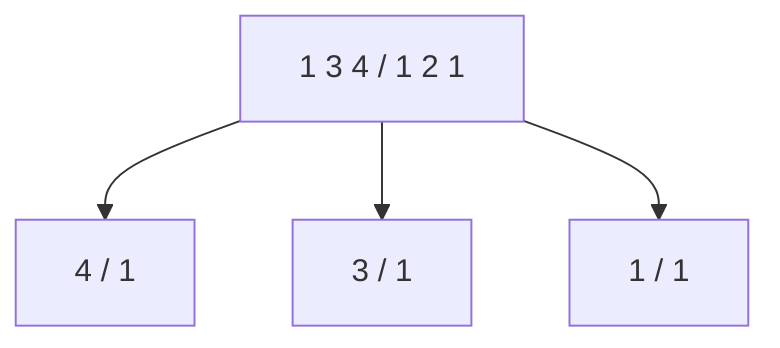

170

If we create such a data structure for each node, we can easily process all given queries, because we can handle all queries related to a node immediately after creating its data structure. For example, the above map structure for node 4 tells us that its subtree contains two nodes whose value is 3.

However, it would be too slow to create all data structures from scratch. Instead, at each node $s$, we create an initial data structure $d[s]$ that only contains the value of $s$. After this, we go through the children of $s$ and *merge* $d[s]$ and all data structures $d[u]$ where $u$ is a child of $s$.

For example, in the above tree, the map for node 4 is created by merging the following maps:

$$\begin{array}{c}
\frac{3}{1} \\
\frac{4}{1} \\
\frac{3}{1} \\
\frac{1}{1}
\end{array}$$

Here the first map is the initial data structure for node 4, and the other three maps correspond to nodes 7, 8 and 9.

The merging at node $s$ can be done as follows: We go through the children of $s$ and at each child $u$ merge $d[s]$ and $d[u]$. We always copy the contents from $d[u]$ to $d[s]$. However, before this, we *swap* the contents of $d[s]$ and $d[u]$ if $d[s]$ is smaller than $d[u]$. By doing this, each value is copied only $O(\log n)$ times during the tree traversal, which ensures that the algorithm is efficient.

To swap the contents of two data structures $a$ and $b$ efficiently, we can just use the following code:

```cpp
swap(a, b);
```

It is guaranteed that the above code works in constant time when $a$ and $b$ are C++ standard library data structures.

## **Lowest common ancestors**

There is also an offline algorithm for processing a set of lowest common ancestor queries<sup>2</sup>. The algorithm is based on the union-find data structure (see Chapter 15.2), and the benefit of the algorithm is that it is easier to implement than the algorithms discussed earlier in this chapter.

The algorithm is given as input a set of pairs of nodes, and it determines for each such pair the lowest common ancestor of the nodes. The algorithm performs a depth-first tree traversal and maintains disjoint sets of nodes. Initially, each node belongs to a separate set. For each set, we also store the highest node in the tree that belongs to the set.

When the algorithm visits a node $x$, it goes through all nodes $y$ such that the lowest common ancestor of $x$ and $y$ has to be found. If $y$ has already been visited, the algorithm reports that the lowest common ancestor of $x$ and $y$ is the highest node in the set of $y$. Then, after processing node $x$, the algorithm joins the sets of $x$ and its parent.

----

<sup>2</sup>This algorithm was published by R. E. Tarjan in 1979 [65].

171

For example, suppose that we want to find the lowest common ancestors of node pairs (5, 8) and (2, 7) in the following tree:

flow_chart: tree diagram with nodes 1 through 8

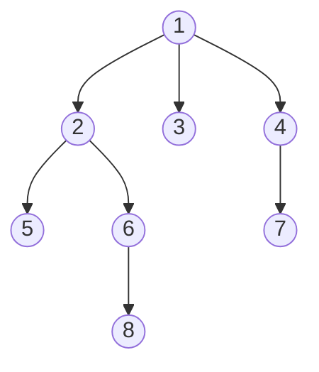

In the following trees, gray nodes denote visited nodes and dashed groups of nodes belong to the same set. When the algorithm visits node 8, it notices that node 5 has been visited and the highest node in its set is 2. Thus, the lowest common ancestor of nodes 5 and 8 is 2:

flow_chart: tree diagram with nodes 1 through 8


Later, when visiting node 7, the algorithm determines that the lowest common ancestor of nodes 2 and 7 is 1:

flow_chart: tree diagram with nodes 1 through 8


172

