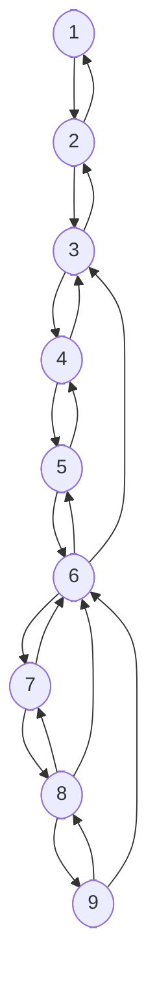

# **Chapter 25**

## **Game theory**

In this chapter, we will focus on two-player games that do not contain random elements. Our goal is to find a strategy that we can follow to win the game no matter what the opponent does, if such a strategy exists.

It turns out that there is a general strategy for such games, and we can analyze the games using the **nim theory**. First, we will analyze simple games where players remove sticks from heaps, and after this, we will generalize the strategy used in those games to other games.

### **Game states**

Let us consider a game where there is initially a heap of $n$ sticks. Players $A$ and $B$ move alternately, and player $A$ begins. On each move, the player has to remove 1, 2 or 3 sticks from the heap, and the player who removes the last stick wins the game.

For example, if $n = 10$, the game may proceed as follows:

* Player $A$ removes 2 sticks (8 sticks left).
* Player $B$ removes 3 sticks (5 sticks left).
* Player $A$ removes 1 stick (4 sticks left).
* Player $B$ removes 2 sticks (2 sticks left).
* Player $A$ removes 2 sticks and wins.

This game consists of states $0, 1, 2, \dots, n$, where the number of the state corresponds to the number of sticks left.

### **Winning and losing states**

A **winning state** is a state where the player will win the game if they play optimally, and a **losing state** is a state where the player will lose the game if the opponent plays optimally. It turns out that we can classify all states of a game so that each state is either a winning state or a losing state.

In the above game, state 0 is clearly a losing state, because the player cannot make any moves. States 1, 2 and 3 are winning states, because we can remove 1,

235

2 or 3 sticks and win the game. State 4, in turn, is a losing state, because any move leads to a state that is a winning state for the opponent.

More generally, if there is a move that leads from the current state to a losing state, the current state is a winning state, and otherwise the current state is a losing state. Using this observation, we can classify all states of a game starting with losing states where there are no possible moves.

The states 0...15 of the above game can be classified as follows (W denotes a winning state and L denotes a losing state):

<table><thead><tr><th>0</th><th>1</th><th>2</th><th>3</th><th>4</th><th>5</th><th>6</th><th>7</th><th>8</th><th>9</th><th>10</th><th>11</th><th>12</th><th>13</th><th>14</th><th>15</th></tr></thead><tbody><tr><td>L</td><td>W</td><td>W</td><td>W</td><td>L</td><td>W</td><td>W</td><td>W</td><td>L</td><td>W</td><td>W</td><td>L</td><td>W</td><td>W</td><td>W</td><td></td></tr></tbody></table>

It is easy to analyze this game: a state $k$ is a losing state if $k$ is divisible by 4, and otherwise it is a winning state. An optimal way to play the game is to always choose a move after which the number of sticks in the heap is divisible by 4. Finally, there are no sticks left and the opponent has lost.

Of course, this strategy requires that the number of sticks is *not* divisible by 4 when it is our move. If it is, there is nothing we can do, and the opponent will win the game if they play optimally.

## **State graph**

Let us now consider another stick game, where in each state $k$, it is allowed to remove any number $x$ of sticks such that $x$ is smaller than $k$ and divides $k$. For example, in state 8 we may remove 1, 2 or 4 sticks, but in state 7 the only allowed move is to remove 1 stick.

The following picture shows the states 1...9 of the game as a **state graph**, whose nodes are the states and edges are the moves between them:

flow_chart: state graph showing nodes 1-9 and directed edges

The final state in this game is always state 1, which is a losing state, because there are no valid moves. The classification of states 1...9 is as follows:

<table><thead><tr><th>1</th><th>2</th><th>3</th><th>4</th><th>5</th><th>6</th><th>7</th><th>8</th><th>9</th></tr></thead><tbody><tr><td>L</td><td>W</td><td>L</td><td>W</td><td>L</td><td>W</td><td>L</td><td>W</td><td>L</td></tr></tbody></table>

Surprisingly, in this game, all even-numbered states are winning states, and all odd-numbered states are losing states.

236

# **Nim game**

The **nim game** is a simple game that has an important role in game theory, because many other games can be played using the same strategy. First, we focus on nim, and then we generalize the strategy to other games.

There are $n$ heaps in nim, and each heap contains some number of sticks. The players move alternately, and on each turn, the player chooses a heap that still contains sticks and removes any number of sticks from it. The winner is the player who removes the last stick.

The states in nim are of the form $[x_1, x_2, \dots, x_n]$, where $x_k$ denotes the number of sticks in heap $k$. For example, $[10, 12, 5]$ is a game where there are three heaps with 10, 12 and 5 sticks. The state $[0, 0, \dots, 0]$ is a losing state, because it is not possible to remove any sticks, and this is always the final state.

## **Analysis**

It turns out that we can easily classify any nim state by calculating the **nim sum** $s = x_1 \oplus x_2 \oplus \dots \oplus x_n$, where $\oplus$ is the xor operation1. The states whose nim sum is 0 are losing states, and all other states are winning states. For example, the nim sum of $[10, 12, 5]$ is $10 \oplus 12 \oplus 5 = 3$, so the state is a winning state.

But how is the nim sum related to the nim game? We can explain this by looking at how the nim sum changes when the nim state changes.

*Losing states:* The final state $[0, 0, \dots, 0]$ is a losing state, and its nim sum is 0, as expected. In other losing states, any move leads to a winning state, because when a single value $x_k$ changes, the nim sum also changes, so the nim sum is different from 0 after the move.

*Winning states:* We can move to a losing state if there is any heap $k$ for which $x_k \oplus s < x_k$. In this case, we can remove sticks from heap $k$ so that it will contain $x_k \oplus s$ sticks, which will lead to a losing state. There is always such a heap, where $x_k$ has a one bit at the position of the leftmost one bit of $s$.

As an example, consider the state $[10, 12, 5]$. This state is a winning state, because its nim sum is 3. Thus, there has to be a move which leads to a losing state. Next we will find out such a move.

The nim sum of the state is as follows:

<table><tr><td>10</td><td>1010</td></tr><tr><td>12</td><td>1100</td></tr><tr><td>5</td><td>0101</td></tr><tr><td>3</td><td>0011</td></tr></table>

In this case, the heap with 10 sticks is the only heap that has a one bit at the position of the leftmost one bit of the nim sum:

<table><tr><td>10</td><td>1010</td></tr><tr><td>12</td><td>1100</td></tr><tr><td>5</td><td>0101</td></tr><tr><td>3</td><td>0011</td></tr></table>

----

1The optimal strategy for nim was published in 1901 by C. L. Bouton [10].

237

The new size of the heap has to be $10 \oplus 3 = 9$, so we will remove just one stick. After this, the state will be $[9, 12, 5]$, which is a losing state:

<table><tr><td>9</td><td>1001</td></tr><tr><td>12</td><td>1100</td></tr><tr><td>5</td><td>0101</td></tr><tr><td>0</td><td>0000</td></tr></table>

## **Misère game**

In a **misère game**, the goal of the game is opposite, so the player who removes the last stick loses the game. It turns out that the misère nim game can be optimally played almost like the standard nim game.

The idea is to first play the misère game like the standard game, but change the strategy at the end of the game. The new strategy will be introduced in a situation where each heap would contain at most one stick after the next move.

In the standard game, we should choose a move after which there is an even number of heaps with one stick. However, in the misère game, we choose a move so that there is an odd number of heaps with one stick.

This strategy works because a state where the strategy changes always appears in the game, and this state is a winning state, because it contains exactly one heap that has more than one stick so the nim sum is not 0.

## **Sprague–Grundy theorem**

The **Sprague–Grundy theorem**2 generalizes the strategy used in nim to all games that fulfil the following requirements:

* There are two players who move alternately.
* The game consists of states, and the possible moves in a state do not depend on whose turn it is.
* The game ends when a player cannot make a move.
* The game surely ends sooner or later.
* The players have complete information about the states and allowed moves, and there is no randomness in the game.

The idea is to calculate for each game state a Grundy number that corresponds to the number of sticks in a nim heap. When we know the Grundy numbers of all states, we can play the game like the nim game.

## **Grundy numbers**

The **Grundy number** of a game state is

$$mex(\{g_1, g_2, \dots, g_n\}),$$

----

2The theorem was independently discovered by R. Sprague [61] and P. M. Grundy [31].

238

where $g_1, g_2, \dots, g_n$ are the Grundy numbers of the states to which we can move, and the mex function gives the smallest nonnegative number that is not in the set. For example, $mex(\{0, 1, 3\}) = 2$. If there are no possible moves in a state, its Grundy number is 0, because $mex(\varnothing) = 0$.

For example, in the state graph

the Grundy numbers are as follows:

The Grundy number of a losing state is 0, and the Grundy number of a winning state is a positive number.

The Grundy number of a state corresponds to the number of sticks in a nim heap. If the Grundy number is 0, we can only move to states whose Grundy numbers are positive, and if the Grundy number is $x > 0$, we can move to states whose Grundy numbers include all numbers $0, 1, \dots, x-1$.

As an example, consider a game where the players move a figure in a maze. Each square in the maze is either floor or wall. On each turn, the player has to move the figure some number of steps left or up. The winner of the game is the player who makes the last move.

The following picture shows a possible initial state of the game, where @ denotes the figure and * denotes a square where it can move.

<table>
    <tr>
      <td></td>
      <td></td>
      <td></td>
      <td></td>
      <td></td>
    </tr>
    <tr>
      <td></td>
      <td></td>
      <td></td>
      <td></td>
      <td></td>
    </tr>
    <tr>
      <td></td>
      <td></td>
      <td></td>
      <td></td>
      <td>*</td>
    </tr>
    <tr>
      <td></td>
      <td></td>
      <td></td>
      <td></td>
      <td>*</td>
    </tr>
    <tr>
      <td>*</td>
      <td>*</td>
      <td>*</td>
      <td>*</td>
      <td>@</td>
    </tr>
</table>

The states of the game are all floor squares of the maze. In the above maze, the Grundy numbers are as follows:

<table>
    <tr>
      <td>0</td>
      <td>1</td>
      <td></td>
      <td>0</td>
      <td>1</td>
    </tr>
    <tr>
      <td></td>
      <td>0</td>
      <td>1</td>
      <td>2</td>
      <td></td>
    </tr>
    <tr>
      <td>0</td>
      <td>2</td>
      <td></td>
      <td>1</td>
      <td>0</td>
    </tr>
    <tr>
      <td></td>
      <td>3</td>
      <td>0</td>
      <td>4</td>
      <td>1</td>
    </tr>
    <tr>
      <td>0</td>
      <td>4</td>
      <td>1</td>
      <td>3</td>
      <td>2</td>
    </tr>
</table>

239

Thus, each state of the maze game corresponds to a heap in the nim game. For example, the Grundy number for the lower-right square is 2, so it is a winning state. We can reach a losing state and win the game by moving either four steps left or two steps up.

Note that unlike in the original nim game, it may be possible to move to a state whose Grundy number is larger than the Grundy number of the current state. However, the opponent can always choose a move that cancels such a move, so it is not possible to escape from a losing state.

## **Subgames**

Next we will assume that our game consists of subgames, and on each turn, the player first chooses a subgame and then a move in the subgame. The game ends when it is not possible to make any move in any subgame.

In this case, the Grundy number of a game is the nim sum of the Grundy numbers of the subgames. The game can be played like a nim game by calculating all Grundy numbers for subgames and then their nim sum.

As an example, consider a game that consists of three mazes. In this game, on each turn, the player chooses one of the mazes and then moves the figure in the maze. Assume that the initial state of the game is as follows:

image: maze placeholder 0
image: maze placeholder 1
image: maze placeholder 2

The Grundy numbers for the mazes are as follows:

<table><tr><td>0</td><td>1</td><td>■</td><td>0</td><td>1</td></tr><tr><td>■</td><td>0</td><td>1</td><td>2</td><td>■</td></tr><tr><td>0</td><td>2</td><td>■</td><td>1</td><td>0</td></tr><tr><td>■</td><td>3</td><td>0</td><td>4</td><td>1</td></tr><tr><td>0</td><td>4</td><td>1</td><td>3</td><td>2</td></tr></table>

<table><tr><td>0</td><td>1</td><td>2</td><td>3</td><td>■</td></tr><tr><td>1</td><td>0</td><td>■</td><td>0</td><td>1</td></tr><tr><td>2</td><td>■</td><td>0</td><td>1</td><td>2</td></tr><tr><td>3</td><td>■</td><td>1</td><td>2</td><td>0</td></tr><tr><td>4</td><td>0</td><td>2</td><td>5</td><td>3</td></tr></table>

<table><tr><td>0</td><td>1</td><td>2</td><td>3</td><td>4</td></tr><tr><td>1</td><td></td><td></td><td></td><td>0</td></tr><tr><td>2</td><td></td><td></td><td></td><td>1</td></tr><tr><td>3</td><td></td><td></td><td></td><td>2</td></tr><tr><td>4</td><td>0</td><td>1</td><td>2</td><td>3</td></tr></table>

In the initial state, the nim sum of the Grundy numbers is $2 \oplus 3 \oplus 3 = 2$, so the first player can win the game. One optimal move is to move two steps up in the first maze, which produces the nim sum $0 \oplus 3 \oplus 3 = 0$.

## **Grundy’s game**

Sometimes a move in a game divides the game into subgames that are independent of each other. In this case, the Grundy number of the game is

$$mex(\{g_1, g_2, \dots, g_n\}),$$

<table>
    <tr>
      <td></td>
      <td></td>
      <td></td>
      <td></td>
      <td></td>
    </tr>
    <tr>
      <td></td>
      <td></td>
      <td></td>
      <td></td>
      <td></td>
    </tr>
    <tr>
      <td></td>
      <td></td>
      <td></td>
      <td></td>
      <td></td>
    </tr>
    <tr>
      <td></td>
      <td></td>
      <td></td>
      <td></td>
      <td></td>
    </tr>
    <tr>
      <td></td>
      <td></td>
      <td></td>
      <td></td>
      <td>@</td>
    </tr>
</table>

<table>
    <tr>
      <td></td>
      <td></td>
      <td></td>
      <td></td>
      <td></td>
    </tr>
    <tr>
      <td></td>
      <td></td>
      <td></td>
      <td></td>
      <td></td>
    </tr>
    <tr>
      <td></td>
      <td></td>
      <td></td>
      <td></td>
      <td></td>
    </tr>
    <tr>
      <td></td>
      <td></td>
      <td></td>
      <td></td>
      <td></td>
    </tr>
    <tr>
      <td></td>
      <td></td>
      <td></td>
      <td></td>
      <td>@</td>
    </tr>
</table>

<table>
    <tr>
      <td></td>
      <td></td>
      <td></td>
      <td></td>
      <td></td>
    </tr>
    <tr>
      <td></td>
      <td></td>
      <td></td>
      <td></td>
      <td></td>
    </tr>
    <tr>
      <td></td>
      <td></td>
      <td></td>
      <td></td>
      <td></td>
    </tr>
    <tr>
      <td></td>
      <td></td>
      <td></td>
      <td></td>
      <td></td>
    </tr>
    <tr>
      <td></td>
      <td></td>
      <td></td>
      <td></td>
      <td>@</td>
    </tr>
</table>

240

where $n$ is the number of possible moves and

$$g_k = a_{k,1} \oplus a_{k,2} \oplus \dots \oplus a_{k,m},$$

where move $k$ generates subgames with Grundy numbers $a_{k,1}, a_{k,2}, \dots, a_{k,m}$.

An example of such a game is **Grundy’s game**. Initially, there is a single heap that contains $n$ sticks. On each turn, the player chooses a heap and divides it into two nonempty heaps such that the heaps are of different size. The player who makes the last move wins the game.

Let $f(n)$ be the Grundy number of a heap that contains $n$ sticks. The Grundy number can be calculated by going through all ways to divide the heap into two heaps. For example, when $n = 8$, the possibilities are $1 + 7$, $2 + 6$ and $3 + 5$, so

$$f(8) = mex(\{f(1) \oplus f(7), f(2) \oplus f(6), f(3) \oplus f(5)\}).$$

In this game, the value of $f(n)$ is based on the values of $f(1), \dots, f(n - 1)$. The base cases are $f(1) = f(2) = 0$, because it is not possible to divide the heaps of 1 and 2 sticks. The first Grundy numbers are:

$$\begin{aligned}
f(1) &= 0 \\
f(2) &= 0 \\
f(3) &= 1 \\
f(4) &= 0 \\
f(5) &= 2 \\
f(6) &= 1 \\
f(7) &= 0 \\
f(8) &= 2
\end{aligned}$$

The Grundy number for $n = 8$ is 2, so it is possible to win the game. The winning move is to create heaps $1 + 7$, because $f(1) \oplus f(7) = 0$.

241

242

