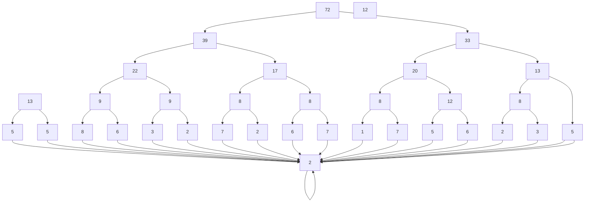
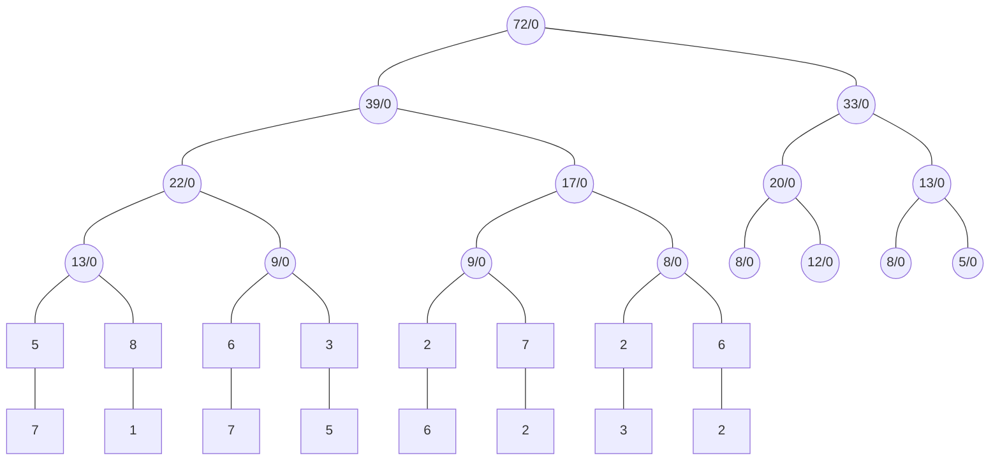
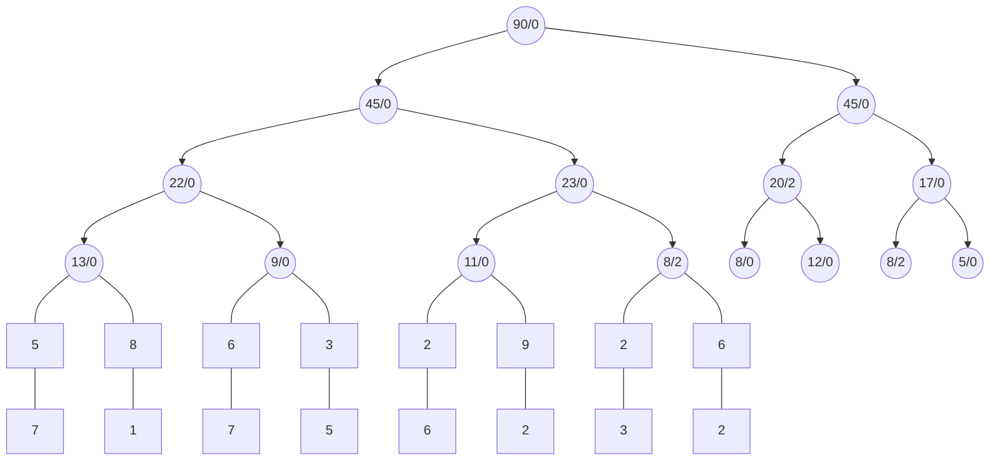
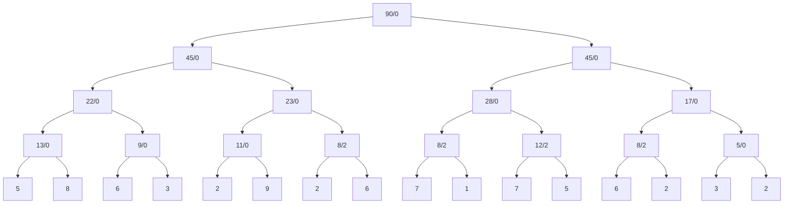
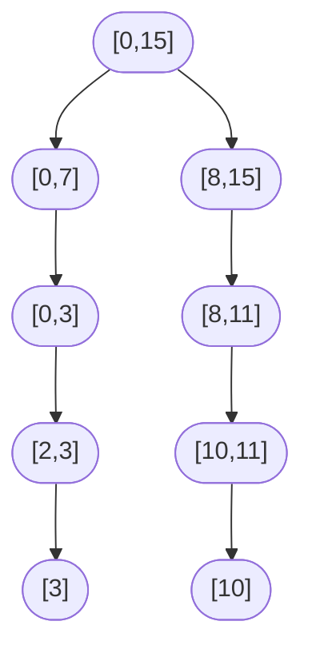
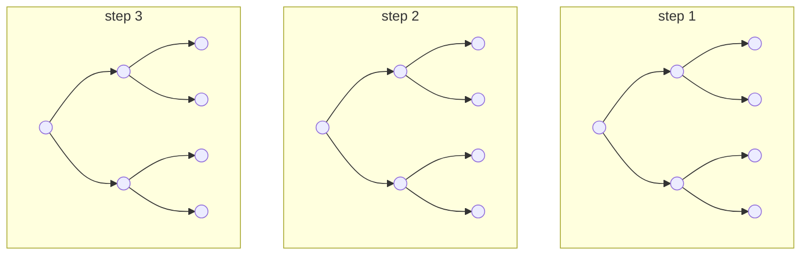
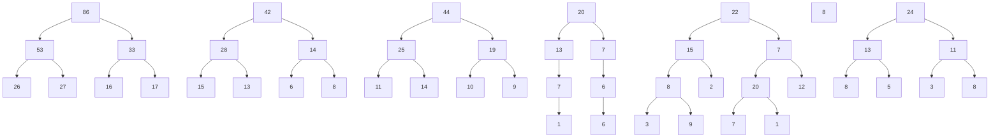

# **Chapter 28**

## **Segment trees revisited**

A segment tree is a versatile data structure that can be used to solve a large number of algorithm problems. However, there are many topics related to segment trees that we have not touched yet. Now is time to discuss some more advanced variants of segment trees.

So far, we have implemented the operations of a segment tree by walking *from bottom to top* in the tree. For example, we have calculated range sums as follows (Chapter 9.3):

```cpp
int sum(int a, int b) {
    a += n; b += n;
    int s = 0;
    while (a <= b) {
        if (a%2 == 1) s += tree[a++];
        if (b%2 == 0) s += tree[b--];
        a /= 2; b /= 2;
    }
    return s;
}
```

However, in more advanced segment trees, it is often necessary to implement the operations in another way, *from top to bottom*. Using this approach, the function becomes as follows:

```cpp
int sum(int a, int b, int k, int x, int y) {
    if (b < x || a > y) return 0;
    if (a <= x && y <= b) return tree[k];
    int d = (x+y)/2;
    return sum(a,b,2*k,x,d) + sum(a,b,2*k+1,d+1,y);
}
```

Now we can calculate any value of $sum_q(a, b)$ (the sum of array values in range $[a, b]$) as follows:

```cpp
int s = sum(a, b, 1, 0, n-1);
```

257

The parameter $k$ indicates the current position in tree. Initially $k$ equals 1, because we begin at the root of the tree. The range $[x, y]$ corresponds to $k$ and is initially $[0, n-1]$. When calculating the sum, if $[x, y]$ is outside $[a, b]$, the sum is 0, and if $[x, y]$ is completely inside $[a, b]$, the sum can be found in tree. If $[x, y]$ is partially inside $[a, b]$, the search continues recursively to the left and right half of $[x, y]$. The left half is $[x, d]$ and the right half is $[d + 1, y]$ where $d = \lfloor \frac{x+y}{2} \rfloor$.

The following picture shows how the search proceeds when calculating the value of $sum_q(a, b)$. The gray nodes indicate nodes where the recursion stops and the sum can be found in tree.

flow_chart: segment tree diagram



Also in this implementation, operations take $O(\log n)$ time, because the total number of visited nodes is $O(\log n)$.

## **Lazy propagation**

Using **lazy propagation**, we can build a segment tree that supports *both* range updates and range queries in $O(\log n)$ time. The idea is to perform updates and queries from top to bottom and perform updates *lazily* so that they are propagated down the tree only when it is necessary.

In a lazy segment tree, nodes contain two types of information. Like in an ordinary segment tree, each node contains the sum or some other value related to the corresponding subarray. In addition, the node may contain information related to lazy updates, which has not been propagated to its children.

There are two types of range updates: each array value in the range is either *increased* by some value or *assigned* some value. Both operations can be implemented using similar ideas, and it is even possible to construct a tree that supports both operations at the same time.

## **Lazy segment trees**

Let us consider an example where our goal is to construct a segment tree that supports two operations: increasing each value in $[a, b]$ by a constant and calculating

258

the sum of values in $[a, b]$.

We will construct a tree where each node has two values $s/z$: $s$ denotes the sum of values in the range, and $z$ denotes the value of a lazy update, which means that all values in the range should be increased by $z$. In the following tree, $z = 0$ in all nodes, so there are no ongoing lazy updates.



When the elements in $[a, b]$ are increased by $u$, we walk from the root towards the leaves and modify the nodes of the tree as follows: If the range $[x, y]$ of a node is completely inside $[a, b]$, we increase the $z$ value of the node by $u$ and stop. If $[x, y]$ only partially belongs to $[a, b]$, we increase the $s$ value of the node by $hu$, where $h$ is the size of the intersection of $[a, b]$ and $[x, y]$, and continue our walk recursively in the tree.

For example, the following picture shows the tree after increasing the elements in $[a, b]$ by 2:



We also calculate the sum of elements in a range $[a, b]$ by walking in the tree from top to bottom. If the range $[x, y]$ of a node completely belongs to $[a, b]$, we add the $s$ value of the node to the sum. Otherwise, we continue the search recursively downwards in the tree.

259

Both in updates and queries, the value of a lazy update is always propagated to the children of the node before processing the node. The idea is that updates will be propagated downwards only when it is necessary, which guarantees that the operations are always efficient.

The following picture shows how the tree changes when we calculate the value of $sum_a(a, b)$. The rectangle shows the nodes whose values change, because a lazy update is propagated downwards.

flow_chart: tree diagram showing lazy update propagation



Note that sometimes it is needed to combine lazy updates. This happens when a node that already has a lazy update is assigned another lazy update. When calculating sums, it is easy to combine lazy updates, because the combination of updates $z_1$ and $z_2$ corresponds to an update $z_1 + z_2$.

## Polynomial updates

Lazy updates can be generalized so that it is possible to update ranges using polynomials of the form

$$p(u) = t_k u^k + t_{k-1} u^{k-1} + \dots + t_0.$$

In this case, the update for a value at position $i$ in $[a, b]$ is $p(i - a)$. For example, adding the polynomial $p(u) = u + 1$ to $[a, b]$ means that the value at position $a$ increases by 1, the value at position $a + 1$ increases by 2, and so on.

To support polynomial updates, each node is assigned $k + 2$ values, where $k$ equals the degree of the polynomial. The value $s$ is the sum of the elements in the range, and the values $z_0, z_1, \dots, z_k$ are the coefficients of a polynomial that corresponds to a lazy update.

Now, the sum of values in a range $[x, y]$ equals

$$s + \sum_{u=0}^{y-x} z_k u^k + z_{k-1} u^{k-1} + \dots + z_0.$$

260

The value of such a sum can be efficiently calculated using sum formulas. For example, the term $z_0$ corresponds to the sum $(y - x + 1)z_0$, and the term $z_1 u$ corresponds to the sum

$$z_1(0 + 1 + \dots + y - x) = z_1 \frac{(y - x)(y - x + 1)}{2}.$$

When propagating an update in the tree, the indices of $p(u)$ change, because in each range $[x, y]$, the values are calculated for $u = 0, 1, \dots, y - x$. However, this is not a problem, because $p'(u) = p(u + h)$ is a polynomial of equal degree as $p(u)$. For example, if $p(u) = t_2 u^2 + t_1 u - t_0$, then

$$p'(u) = t_2(u + h)^2 + t_1(u + h) - t_0 = t_2 u^2 + (2ht_2 + t_1)u + t_2 h^2 + t_1 h - t_0.$$

## **Dynamic trees**

An ordinary segment tree is static, which means that each node has a fixed position in the array and the tree requires a fixed amount of memory. In a **dynamic segment tree**, memory is allocated only for nodes that are actually accessed during the algorithm, which can save a large amount of memory.

The nodes of a dynamic tree can be represented as structs:

```c
struct node {
    int value;
    int x, y;
    node *left, *right;
    node(int v, int x, int y) : value(v), x(x), y(y) {}
};
```

Here value is the value of the node, $[x, y]$ is the corresponding range, and left and right point to the left and right subtree.

After this, nodes can be created as follows:

```c
// create new node
node *x = new node(0, 0, 15);

// change value
x->value = 5;
```

## **Sparse segment trees**

A dynamic segment tree is useful when the underlying array is *sparse*, i.e., the range $[0, n - 1]$ of allowed indices is large, but most array values are zeros. While an ordinary segment tree uses $O(n)$ memory, a dynamic segment tree only uses $O(k \log n)$ memory, where $k$ is the number of operations performed.

A **sparse segment tree** initially has only one node $[0, n - 1]$ whose value is zero, which means that every array value is zero. After updates, new nodes are dynamically added to the tree. For example, if $n = 16$ and the elements in positions 3 and 10 have been modified, the tree contains the following nodes:

261

flow_chart: segment tree diagram



Any path from the root node to a leaf contains $O(\log n)$ nodes, so each operation adds at most $O(\log n)$ new nodes to the tree. Thus, after $k$ operations, the tree contains at most $O(k \log n)$ nodes.

Note that if we know all elements to be updated at the beginning of the algorithm, a dynamic segment tree is not necessary, because we can use an ordinary segment tree with index compression (Chapter 9.4). However, this is not possible when the indices are generated during the algorithm.

## **Persistent segment trees**

Using a dynamic implementation, it is also possible to create a **persistent segment tree** that stores the *modification history* of the tree. In such an implementation, we can efficiently access all versions of the tree that have existed during the algorithm.

When the modification history is available, we can perform queries in any previous tree like in an ordinary segment tree, because the full structure of each tree is stored. We can also create new trees based on previous trees and modify them independently.

Consider the following sequence of updates, where red nodes change and other nodes remain the same:

flow_chart: tree diagram showing three steps



After each update, most nodes of the tree remain the same, so an efficient way to store the modification history is to represent each tree in the history as a

262

combination of new nodes and subtrees of previous trees. In this example, the modification history can be stored as follows:

step 1
step 2
step 3

The structure of each previous tree can be reconstructed by following the pointers starting at the corresponding root node. Since each operation adds only $O(\log n)$ new nodes to the tree, it is possible to store the full modification history of the tree.

## **Data structures**

Instead of single values, nodes in a segment tree can also contain *data structures* that maintain information about the corresponding ranges. In such a tree, the operations take $O(f(n)\log n)$ time, where $f(n)$ is the time needed for processing a single node during an operation.

As an example, consider a segment tree that supports queries of the form "how many times does an element $x$ appear in the range $[a, b]$?" For example, the element 1 appears three times in the following range:

<table>
  <tr>
    <td>3</td>
    <td><mark>1</mark></td>
    <td>2</td>
    <td><mark>3</mark></td>
    <td><mark>1</mark></td>
    <td><mark>1</mark></td>
    <td>1</td>
    <td>2</td>
  </tr>
</table>

To support such queries, we build a segment tree where each node is assigned a data structure that can be asked how many times any element $x$ appears in the corresponding range. Using this tree, the answer to a query can be calculated by combining the results from the nodes that belong to the range.

For example, the following segment tree corresponds to the above array:

<table>
  <tr>
    <th>Range</th>
    <th>Count</th>
  </tr>
<tr>
    <td><u>1 2 3</u><br />4 2 2</td>
    <td>4 2 2</td>
  </tr>
<tr>
    <td><u>1 2 3</u><br />1 1 2</td>
    <td>1 1 2</td>
    <td>1 2<br />3 1</td>
  </tr>
<tr>
    <td>1 3<br />1 1</td>
    <td>1 1</td>
    <td>2 3<br />1 1</td>
    <td>1 2<br />3 1</td>
  </tr>
<tr>
    <td>3<br />1</td>
    <td>1</td>
    <td>1<br />1</td>
    <td>2<br />1</td>
    <td>3<br />1</td>
  </tr>
<tr>
    <td>1<br />2</td>
    <td>2</td>
    <td>1 2<br />1 1</td>
    <td>1<br />1</td>
    <td>1<br />1</td>
    <td>2<br />1</td>
  </tr>
</table>

263

We can build the tree so that each node contains a map structure. In this case, the time needed for processing each node is $O(\log n)$, so the total time complexity of a query is $O(\log^2 n)$. The tree uses $O(n \log n)$ memory, because there are $O(\log n)$ levels and each level contains $O(n)$ elements.

## **Two-dimensionality**

A **two-dimensional segment tree** supports queries related to rectangular subarrays of a two-dimensional array. Such a tree can be implemented as nested segment trees: a big tree corresponds to the rows of the array, and each node contains a small tree that corresponds to a column.

For example, in the array

<table><tr><td>7</td><td>6</td><td>1</td><td>6</td></tr><tr><td>8</td><td>7</td><td>5</td><td>2</td></tr><tr><td>3</td><td>9</td><td>7</td><td>1</td></tr><tr><td>8</td><td>5</td><td>3</td><td>8</td></tr></table>

the sum of any subarray can be calculated from the following segment tree:

flow_chart: Two-dimensional segment tree diagram



The operations of a two-dimensional segment tree take $O(\log^2 n)$ time, because the big tree and each small tree consist of $O(\log n)$ levels. The tree requires $O(n^2)$ memory, because each small tree contains $O(n)$ values.

264

